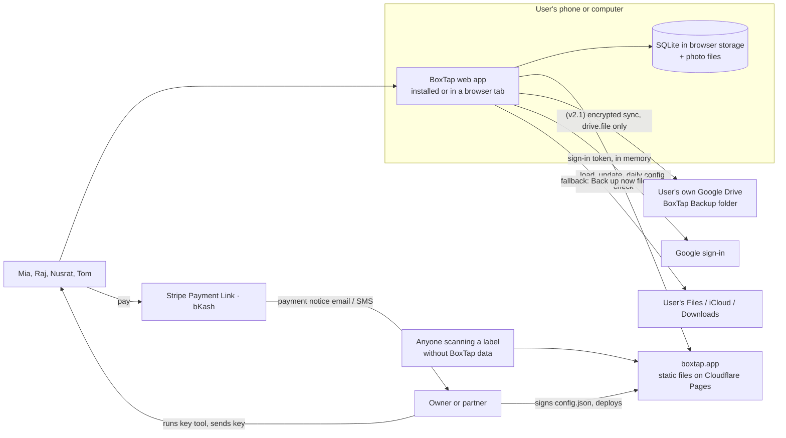
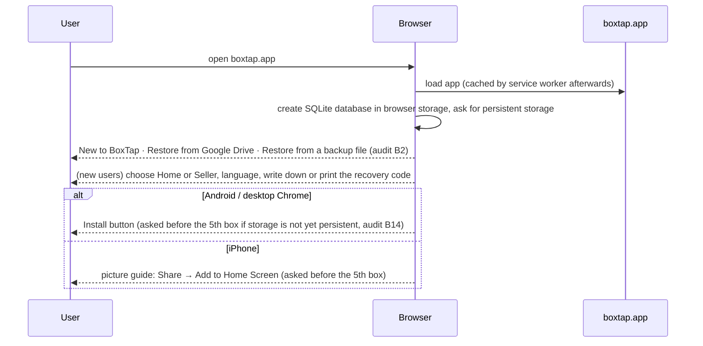
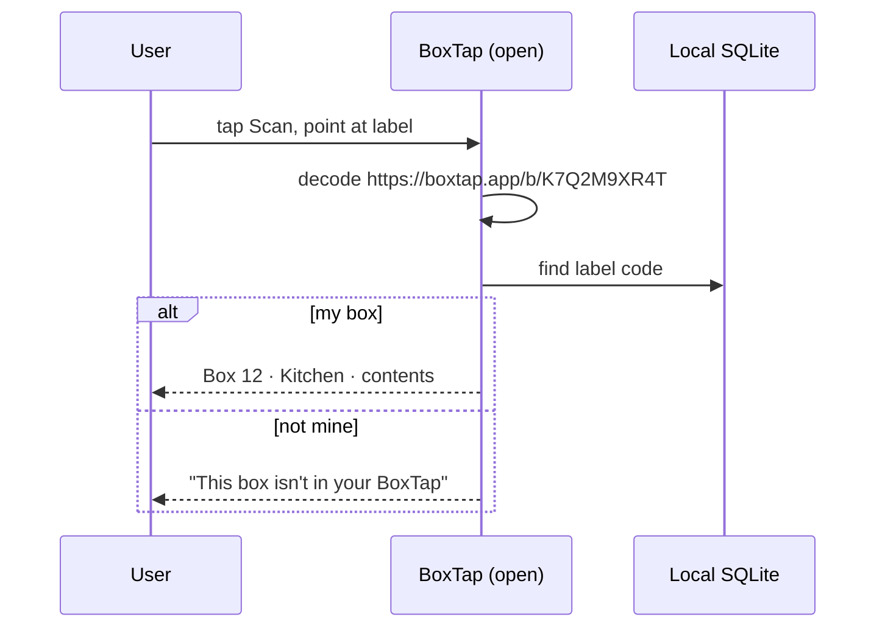
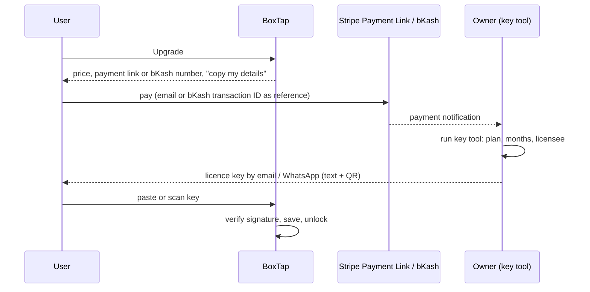
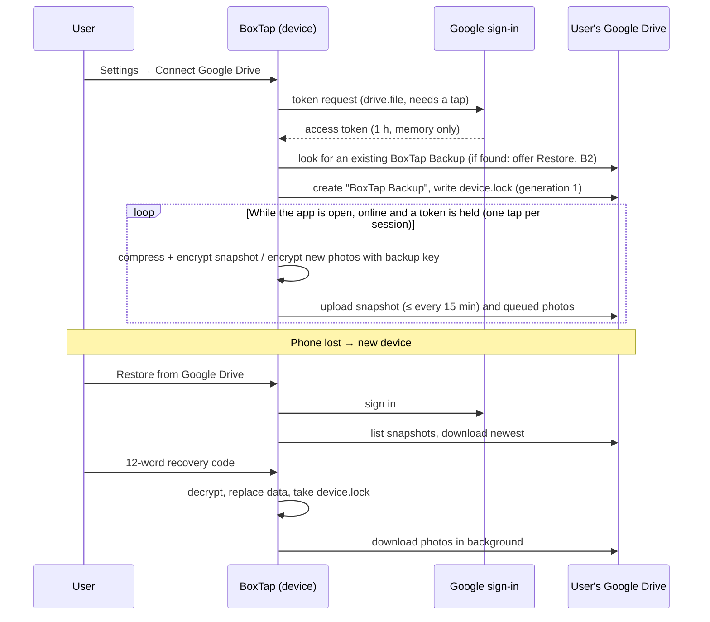

# BoxTap — System Architecture (v2.1, web app, local-first, manual licence keys, Google Drive backup)

Version 2.1 · 2026-11-25 · Based on the requirements doc (2026-11-22), the gap review, the owner's decisions of 2026-11-23 (local-first, no app stores, manual licence keys) and the request of 2026-11-25 (customers keep data and photos in their own Google Drive). v2.1 changes from v2.0 are marked **(v2.1)**.
Decisions: [ADR.md](ADR.md). Options considered: [PWA_PROPOSAL.md](PWA_PROPOSAL.md). Earlier versions in `archive/`.

## 1. Summary

BoxTap is a **Progressive Web App** served from `boxtap.app`. People open it in a browser on a phone or computer and can install it to the home screen. All boxes, items, photos and stock live **in that browser's own storage on that device**, in a SQLite database. **There is no server code at all**: the website is static files.

**(v2.1)** Each user can connect **their own Google Drive**. BoxTap then keeps an encrypted copy of all data and photos there, so a lost phone or a new device is no longer a disaster. The device stays the main store; Drive is the safety copy. The owner pays nothing for this storage and never sees the data.

The owner controls money and features with **signed licence keys** made on their own computer and a **signed config file** on the website. Australians pay through a **Stripe Payment Link**; Bangladeshi sellers pay by **bKash**; the owner then sends a key.

Fixed running cost: about **US$15 a year** (domain). Per-sale cost: Stripe card fees (about 1.65% + A$0.30, domestic) or bKash fees.

## 2. Context



Nothing the user types ever leaves their device unencrypted. It goes out only as files they choose to share, or as encrypted backups to their own Google Drive if they connect it.

## 3. Module boundaries

```mermaid
flowchart TB
  subgraph Core [Shared core]
    DATA[data<br/>SQLite worker, migrations, repositories]
    WS[workspaces]
    LOC[locations + labels<br/>QR codes, PDF labels, scanner]
    ITEM[items + photos + search]
    LIC[licensing<br/>keys, signed config, trusted time, can()]
    BAK[backup<br/>recovery code, backup file, restore]
    GSYNC[drive sync v2.1<br/>Google sign-in, upload queue,<br/>device lock, restore from Drive]
    PWA[pwa shell<br/>service worker, install guide, updates]
    I18N[i18n<br/>English, Bangla]
    SHARE[share out<br/>PDF, image, CSV]
  end
  subgraph Home [Home mode]
    ROOMS[rooms, flags, spot]
    MOVE[move status, arrival check]
    INS[insurance PDF]
  end
  subgraph Seller [Seller mode]
    STOCK[stock ledger: +/−, booked, undo]
    LOW[low stock list]
    COUNT[count mode, move between boxes]
    CAT[catalogue image]
    PRO[Pro: products, variants, cost/profit, orders, reports]
  end
  Home --> Core
  Seller --> Core
```

Rules: mode modules use core, never the reverse. Screens call repositories, never SQL. Every premium check goes through `can(feature)` in `licensing`. The SQLite engine runs in a Web Worker so the screen never freezes.

## 4. Technology

| Concern | Choice | Notes |
| --- | --- | --- |
| UI | React 18 + TypeScript + Vite + Tailwind | Reused from earlier plans |
| PWA | `vite-plugin-pwa` (Workbox), web app manifest | Offline shell, install, update prompt |
| Database | `@sqlite.org/sqlite-wasm` in a Web Worker, OPFS `opfs-sahpool` | ADR-003; IndexedDB fallback driver |
| Photos | OPFS files; 1600 px (~200 KB) + 400 px thumbnail, made in the browser | **Audit B12:** decode with `createImageBitmap(file, {resizeWidth})` (a 48 MP photo decoded at full size can crash a low-cost phone); encode WebP, and if the browser returns another type (Safari, Fact) use JPEG q≈0.8; the type is stored in `photos.mime` |
| Camera | `getUserMedia` (HTTPS) and `<input type="file" capture>` for photos | |
| QR decoding | `BarcodeDetector` → `zxing-wasm` fallback | ADR-007 |
| PDF / labels | `pdf-lib` + `qrcode` | |
| Search | SQLite FTS5 trigram | |
| Crypto | WebCrypto (AES-GCM), `@noble/ed25519`, Argon2id (WASM) | Licence and config signatures, backups |
| Sharing | Web Share API (files), download fallback | Backups, PDFs, images, CSV |
| **(v2.1)** Google sign-in | Google Identity Services token model, loaded on demand; redirect fallback | ADR-020; token in memory only |
| **(v2.1)** Drive access | Drive API v3 over `fetch` (multipart uploads with pre-reserved file IDs, audit B10), scope `drive.file` | No Google client library beyond sign-in |
| i18n | i18next, `en.json`, `bn.json`, Noto Sans Bengali subset self-hosted | |
| Hosting | Cloudflare Pages | Static only |
| Owner tools | Node + TypeScript scripts on the owner's computer | Keys, config signing, licence log |

## 5. Key flows

### 5.1 First visit and install



On iPhone the data lives with the home-screen app, so the guide asks users to install **before** entering much data. Data entered in a Safari tab stays in Safari and is not moved automatically; the app offers "Back up here, restore in the installed app" if needed.

### 5.2 Scan a label



Opening the link from the phone's camera app works when it opens the same browser that holds the data (Android Chrome, desktop). On iPhone it opens Safari without data, which shows "Open BoxTap and tap Scan".

### 5.3 Buy a plan (manual keys)



Service promise (Recommendation): keys sent within 24 hours; the upgrade screen says so.

### 5.4 Back up and restore

**(v2.1) Main path, Google Drive:**



**Fallback:** Settings → Back up now → encrypted file → share sheet or download; restore from that file. Desktop Chrome/Edge can still save automatically to a chosen folder. Details: [API_CONTRACTS.md §6 and §6.1](API_CONTRACTS.md).

## 6. Browser support and limits

| Feature | Android Chrome | iPhone Safari (iOS 17+) | Desktop Chrome/Edge | Desktop Safari/Firefox |
| --- | --- | --- | --- | --- |
| Install | Prompt | Manual (Share → Add to Home Screen) | Install button | Bookmark / Safari "Add to Dock" |
| SQLite on OPFS | Yes | Yes (Assumption: iOS 17+, verify) | Yes | Yes (Firefox 111+, Safari 17+) |
| Long-term storage | Persistent when installed | Home-screen app: kept; Safari tab: may be deleted after 7 days unused (Fact, WebKit policy) | Persistent when installed | Best effort |
| QR decode | Native | WASM | Native / WASM | WASM |
| Backup **(v2.1)** | Google Drive while open, one tap per session (B3); file fallback | Google Drive while open, one tap per session (sign-in in home-screen app: spike R11); file fallback | Google Drive, or automatic to a folder | Google Drive; manual download |
| Wi-Fi-only photo uploads | Yes (detects network type) | No (Safari can't tell); "Pause photo uploads" | Yes on Chrome/Edge | Pause only |
| Notifications when closed | Not in MVP | Not in MVP | Not in MVP | Not in MVP |

Minimum support: the last two major versions of each browser; iOS 17+. Older browsers see a clear "Please update your browser" page.

### 6.1 Edge cases the app must handle (from the audit)

| Case | Handling |
| --- | --- |
| BoxTap open in two tabs or windows (audit W2) | The SQLite storage driver allows one connection. The first tab takes a Web Lock; others show "BoxTap is open in another tab" with a "Use here instead" button. **Audit B13a:** common on Android, where scanning a label with the camera app opens a Chrome tab beside the installed app. On a steal, the old tab is told (BroadcastChannel + lock loss), stops sync, closes the database and releases the storage handles; the new tab retries for about 5 s, then says "Close the other BoxTap window" (a frozen background tab may hold the handles). Manifest `launch_handler: focus-existing` where supported |
| Private / incognito window (W9) | Detected from storage estimates and `persist()`; banner: "Private window: your boxes will be deleted when you close it" |
| Storage full (W5) | `QuotaExceededError` is caught; new photos are blocked with a message, the database transaction rolls back cleanly, text edits keep working |
| A bad release reaches users (W3) | Updates are offered, not forced ("New version, tap to update"); Cloudflare Pages instant rollback to the previous deployment; migrations always after a safety copy |
| Backup too large to share on a phone (W6) | Falls back to download; offers "Back up without photos" as a second option |
| Data entered in an iPhone Safari tab, then installed (W1) | Install guide before the 5th box; "Move my data to the installed app" uses backup → restore (v2.1: or Drive restore) |
| **(v2.1)** Google token ends while working, or the app was reopened (W12, audit B3) | No silent renewal exists in the browser, so a tap is needed once per session and after each hour; the "Tap to back up" chip shows only when changes are waiting; nothing is lost |
| **(audit B14)** Android Chrome did not grant persistent storage | `navigator.storage.persisted()` checked at every start; if false, a "Not protected yet: install BoxTap or connect Google Drive" banner, and Android users are asked to install before the 5th box (Chrome may evict a non-persistent site when the phone is full, Fact) |
| **(audit B2)** New phone: user connects Drive instead of restoring | Connect finds the existing backup and offers "Restore it" first; it never overwrites it (API_CONTRACTS §6.2) |
| **(v2.1)** Two devices restored from the same Drive (W13) | `device.lock` decides; the older device stops syncing and says why |
| **(v2.1)** Google storage full (W14) | Photo uploads pause, snapshots continue (small); banner with the Google One link |
| **(v2.1)** User deletes the Drive folder | Deleting in Drive only trashes it (audit B9): the app notices `trashed`, offers "Restore from Drive trash" or a new folder; if gone for good, recreated and re-uploaded after a notice |
| **(v2.1)** App closed before uploads finish | Queue survives in `drive_outbox`; resumes next time the app opens; home screen shows "12 photos waiting" |


## 7. Infrastructure and release

| Piece | Where | Cost |
| --- | --- | --- |
| Code, CI | GitHub + GitHub Actions | US$0 |
| Website and app | Cloudflare Pages (preview per branch, production on `main`) | US$0 |
| Config file | Same site, `config/v1.json`, signed locally then committed | US$0 |
| Payments | Stripe Payment Links; bKash number (partner) | Fees per sale |
| Owner tools and private keys | Owner's computer; offline backup of keys | US$0 |

**Release:** merge to `main` → CI tests → Cloudflare Pages deploys → open copies of the app see "New version available, tap to update" (service worker). Database migrations run on the next start, after a safety copy.

## 8. Requirement traceability

| Requirement | Web app design |
| --- | --- |
| C-01 sign-up | No account; first-launch choice of mode and language (< 1 min) |
| C-02 workspaces | Several on one device, never mixed |
| C-03 boxes, 30-day bin | Kept |
| C-04/05 private QR | In-app lookup; landing page shows nothing |
| C-06, G1 contents photo | Kept |
| C-07 search < 1 s | FTS5 |
| C-08 labels | Kept |
| C-09 offline | Whole app offline after first load |
| C-10 photos | Compressed in the browser; stored locally |
| C-11 billing, limits | Manual keys + `can()`; limits from signed config |
| C-12 languages | Kept |
| C-13 export, delete | CSV and backup export; Settings → Erase all data |
| C-14 KPIs | Licence log, Stripe dashboard, Cloudflare Web Analytics |
| H-04 Move Pass | 12-month key, A$12.95 via payment link |
| H-05 share link | Replaced by PDF/image share |
| H-06 never lose access | Expired keys block only new boxes/photos |
| H-07 insurance PDF | Kept |
| H-08 reminder emails | In-app reminders |
| S-01 to S-10 | Kept, in the browser |
| S-11 offline / two phones | Offline yes; two phones deferred |
| S-21 low-stock alerts | In-app list and badge |
| S-22 staff | Deferred until sync |
| S-27 Play Store | Dropped (no stores) |
| N-01 devices | Android, iPhone, desktop browsers |
| N-07 security | [SECURITY_MODEL.md](SECURITY_MODEL.md) |
| N-10 backups | ADR-020 (Google Drive), ADR-016 (file fallback) |
