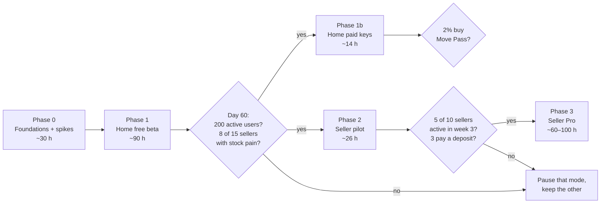

# BoxTap — Implementation Roadmap (v2.1, web app, manual keys, Google Drive backup)

Phases and checkpoints follow the requirements doc. Hours are estimates 📐. **Nothing here authorises code changes; implementation starts only after the owner approves and names a GitHub repository.**

Checkpoint note: with no accounts, "sign-ups" become **first launches that create at least one box**, counted with an anonymous, cookieless page view on the "first box created" screen in Cloudflare Web Analytics (Assumption: owner accepts this one anonymous count).

## Phase 0 — Foundations and spikes (~30 h; was ~15 h, re-estimated in the pre-build audit, B16)

| Work | Acceptance |
| --- | --- |
| Repo: Vite + React + TS + Tailwind + `vite-plugin-pwa`; ESLint; Vitest; Playwright (3 engines) | CI green; preview URL per branch on Cloudflare Pages |
| Spike: SQLite WASM + OPFS `opfs-sahpool` + FTS5 trigram on Safari 17+, Chrome, Firefox (R6) | Works, or fallback chosen |
| Spike: camera + `zxing-wasm` scan on iPhone Safari and home-screen app | Scans a printed label in < 1 s |
| Web Lock single-tab guard; persistent storage request | Critical tests 4, 5 |
| Owner tools: `keys.ts`, `licence.ts`, `config.ts` | Generated key and config verify in the app |
| Security headers (`_headers`, CSP), 2FA on accounts | Checklist items done |
| **(v2.1)** Spike: Google sign-in (pop-up, then redirect) + one encrypted upload and download, on iPhone home-screen app, Safari tab, Android Chrome, desktop (R11) | Works on all four, or iPhone falls back to file backup (owner told) |
| **(v2.1)** Owner: Google Cloud project (in an organisation or with two owner accounts, deletion protected), **production** OAuth web client (origin `https://boxtap.app` only) and a separate **test** client (fixed branch alias such as `staging.<project>.pages.dev`; per-deploy preview URLs can't be registered, Fact), consent screen, domain verification (R15, audit B4) | Client IDs in the builds; consent screen submitted |
| **(audit)** Spike adds: pop-up vs. tap behaviour for renewals (B3), WebP encoding on Safari (B12), lock steal from a frozen Android tab (B13a), `persist()` on Android (B14), CSP via `wrangler pages dev` (B1) | Results written into the docs before Phase 1 |

## Phase 1 — Home free beta (~90 h, weeks 2–10; was ~58 h, re-estimated in the pre-build audit, B16)

C-03–C-10, C-12 basics, C-13, H-01–H-03, G1, G5, G6, arrival check, install guide, backups.

| Step | Depends on | Acceptance |
| --- | --- | --- |
| 1. First launch: mode, language, recovery code; install guide | 0 | < 1 min; iPhone guide before 5th box |
| 2. Rooms, boxes, items, photos | 1 | CRUD, 30-day bin, critical test 11 |
| 3. Labels + PDF | 2 | Print test on 3 printers |
| 4. In-app scanner + `/b/:code` route | 3 | Critical tests 6–8 |
| 5. Search | 2 | 400 items < 1 s |
| 6. Free limits via `can()` + built-in config | 2 | Critical test 12 |
| 7. Backup and restore (file fallback) | 2 | Critical tests 9, 10 |
| 7b. **(v2.1)** Google Drive backup, in two slices (audit B16): **7b-1** connect with existing-backup check, encrypted snapshots with generation/sequence, retention, restore (crash-safe, version-aware), disconnect (~25 h). **7b-2** photo upload/download queue, trash and quota handling, takeover check (~15 h). If time is short, 7b-2 moves after the day-60 gate and photos stay in the file backup | 7 | Critical tests 24–41 |
| 8. Offline, update prompt, launch on boxtap.app | all | Critical tests 1–3, 18 |

## Phase 1b — Home paid keys (~14 h, weeks 8–9)

**Skipped for now (owner decision, 2026-11-25):** licence key entry, payment links and renewal reminders are postponed; build continues with Seller mode (Phase 2). The licensing core (`can()`, key and config verification, owner tools) already exists; free limits apply until 1b is built.

Upgrade screen with Stripe Payment Link, key entry (paste + scan), Settings "Licensed to", stacking, `trustedNow()`, signed config live, revocation, H-07 insurance PDF, family/removalist PDFs, in-app renewal reminders. Owner runbook rehearsed with 3 test sales.
Acceptance: critical tests 13–17.

## Phase 2 — Seller pilot (~26 h, weeks 9–12)

Seller workspace, S-01–S-10, booked tap, jewellery fields, `alt_name` search, catalogue image, Bangla screens; pilot sellers get free signed keys from the owner; bKash payment instructions for the founding-member fee.
Acceptance: critical tests 19–23; catalogue image shares to WhatsApp from a low-cost Android phone.

## Phase 3 — Seller Pro (~60–100 h, only if Phase 2 passes)

S-20, S-21 (in-app), S-23, S-24, S-26; multi-month Seller Pro keys. Decide from evidence: licence service (automatic payments) and/or sync for staff and two phones (+25–40 h each).

## Definition of done

Reviewed, tests passing in CI, migrations tested from every earlier schema version, docs updated in the same PR, checked on Android Chrome and an iPhone home-screen app.
