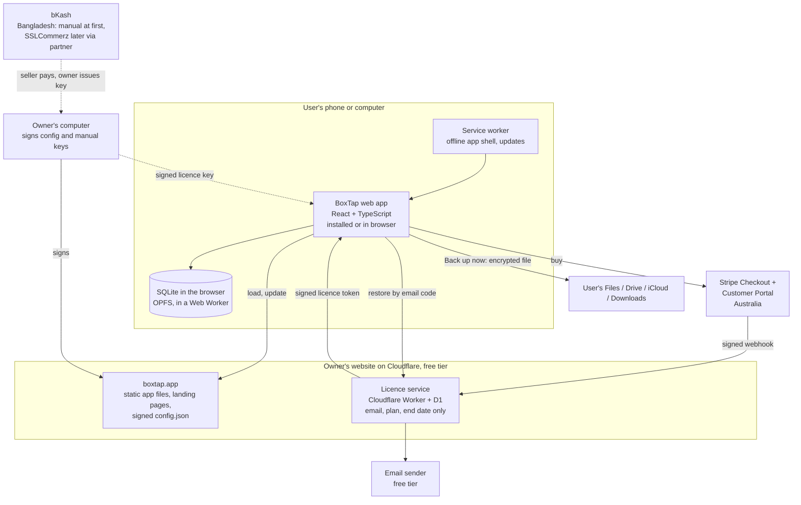
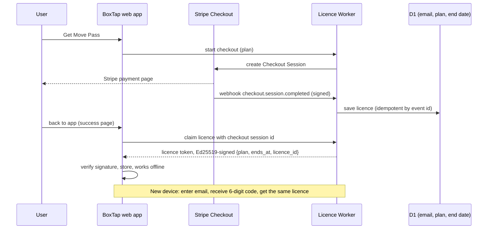

# BoxTap — Web App (PWA) Proposal, no app stores

Version 0.1 · 2026-11-23 · **Status: Decided.** The owner chose the PWA with fully manual keys (Option C) on 2026-11-23; the design is in ARCHITECTURE.md v2.0.

Labels: **Fact**, **Assumption**, **Recommendation**, **Open decision**.

## 1. The owner's requirements (confirmed, 2026-11-23)

1. Hosted on the owner's website; **not** on the App Store, Google Play or any marketplace.
2. Users open it in any browser (phone or desktop) and can install it to the home screen.
3. Camera, QR scanning and other device features through the browser, where supported.
4. Local-first: data on the user's device; no Supabase, Firebase or paid database.
5. No monthly database costs; the lowest possible running cost.
6. Full owner control of licences, subscriptions, premium features and user access; free and paid plans.
7. Core features offline; internet only for subscription checks, updates and similar.

## 2. The short answer

All seven are achievable. Most of the v1.0 design carries over unchanged (on-device SQLite schema, stock ledger, labels, backups, signed config, licence keys). Two things must change:

1. **Without app stores, something must receive payments and confirm them.** A payment provider can't talk to a phone directly, so the cheapest reliable route is a **tiny licence service on Cloudflare's free tier** (Workers + D1) that receives Stripe's payment notices and hands out signed licences. It stores only an email, a plan and an end date — no box or stock data. Fixed cost about **US$0**, plus card fees per sale.
2. **iPhone browsers have real limits** (§4). They are workable, but only if iPhone users install BoxTap to their home screen and back up regularly.

Fixed running cost: about **US$15 a year** (domain). No 15% store commission; card fees instead (Stripe Australia about 1.65% + A$0.30 per domestic card, per the requirements doc's source).

## 3. Architecture overview

## 4. Browser and iPhone limits, honestly

| Feature | Android (Chrome) | iPhone (Safari) | Desktop browsers | What BoxTap does |
| --- | --- | --- | --- | --- |
| Install to home screen | Install prompt available | **No prompt.** User taps Share → Add to Home Screen | Install button in Chrome/Edge | Step-by-step install guide with pictures; on iPhone, ask to install before adding many boxes |
| Data kept long-term | Kept; installed apps can get persistent storage | **Safari can delete a website's data after 7 days without use** if it is not added to the Home Screen ([WebKit storage policy](https://webkit.org/?p=14403)) (Fact). Home-screen web apps are not subject to that 7-day rule, but data can still be lost if the user clears Safari data or deletes the icon (Assumption, re-check on current iOS) | Kept unless the user clears site data | Require home-screen install on iPhone for paid plans; ask for persistent storage; strong backup reminders |
| Camera | Yes | Yes (HTTPS) | Yes (webcam) | Camera inside the app |
| QR scanning | Native `BarcodeDetector` | Not available; use a WebAssembly scanner (`zxing-wasm`) | Mixed | Scanner inside the app for all |
| Scanning a label with the **phone's own camera app** | Opens Chrome; may open the installed app (link capture varies, Assumption) | **Opens Safari, whose storage is separate from the home-screen app (Fact). Safari has no data, so it can't show the box** | — | Landing page says "Open BoxTap and tap Scan". The in-app Scan button is the main path |
| Offline | Yes (service worker) | Yes | Yes | Whole app works offline |
| Automatic backups to Drive/iCloud | **No silent background saving from a browser** | No | Chrome/Edge can save to a chosen folder automatically (File System Access API) | "Back up now" creates an encrypted file and opens the share sheet / download; reminder banner every 7 days; desktop can auto-save |
| Notifications when the app is closed | Web Push needs a push server | Only for home-screen apps, iOS 16.4+ (Fact) | Yes | In-app reminders only in the MVP (no push server) |
| Updates | Instant, no store review | Instant | Instant | Service worker shows "New version, tap to update" |
| Desktop use | — | — | **Works** | Desktop is back in scope |

## 5. Payments and licences: options

| Option | How it works | Owner control | Fixed cost | Per-sale cost | Bangladesh | Build effort 📐 |
| --- | --- | --- | --- | --- | --- | --- |
| **A. Own licence service (Recommended)** | Stripe Checkout + Customer Portal for cards; Stripe webhook → Cloudflare Worker → D1 record → signed licence token to the app. bKash handled by manual keys first | Full: plans, prices, refunds, revoke, promos | ≈ US$0 (Workers free tier allows about 100,000 requests a day, [Cloudflare](https://developers.cloudflare.com/workers/platform/pricing/)) | Stripe ~1.65% + A$0.30 | Manual bKash keys now; SSLCommerz via partner later | ~20–25 h |
| B. Merchant of Record with built-in licence keys (e.g. [Lemon Squeezy License API](https://docs.lemonsqueezy.com/api/license-api)) | Provider sells, handles tax, emails a licence key; the app activates and validates the key with the provider's API | Good dashboard; less flexible | US$0 | About 5% + US$0.50 (Assumption, re-check) | No bKash | ~8–12 h |
| C. Fully manual | Owner sells via a Stripe Payment Link or bKash, then sends a signed licence key by hand | Full, but manual | US$0 | Stripe / bKash fees | Yes | ~4 h |

**Recommendation:** **A for card payments (Home Move Pass and Australian Seller Pro), plus C for Bangladesh sellers** until volume justifies an SSLCommerz integration through the partner. Both produce the same kind of signed licence, so the app treats them alike.

### 5.1 How Option A works

- **Licence token** valid until the plan's end date (Move Pass) or the paid-up period + 3 days (Seller Pro monthly). The app refreshes it when online, at most once a day.
- **Subscriptions:** Stripe Billing renews Seller Pro; the Customer Portal (hosted by Stripe, free) lets users cancel or change cards. Webhooks update D1.
- **Move Pass renewal:** buying again extends from the current end date (ADR-014 still holds).
- **Restore / new device:** email + one-time code (sent through a free-tier email service). No passwords.
- **Owner control:** a small admin page protected by Cloudflare Access (free for small teams) to look up a licence, extend it, refund (via Stripe) or revoke.
- **Keys:** the Worker holds its own signing key as a Cloudflare secret (separate from the owner's offline config key), so a leak can be contained by revoking that key ID in config.

## 6. What carries over from v1.0, and what changes

| Part | v1.0 (stores) | PWA |
| --- | --- | --- |
| Database schema, stock ledger, triggers, FTS5 | SQLite (SQLCipher) | **Same SQLite schema**, running in the browser (official SQLite WebAssembly build with OPFS in a Web Worker). FTS5 is included in that build (Assumption, verify in Phase 0) |
| Encryption at rest | SQLCipher + Keystore | Device encryption from the OS. A browser cannot hide a key from someone holding the unlocked device, so app-level encryption adds little; **optional passcode** encrypts the data with a key derived from the passcode (Recommendation: optional) |
| Billing | Play / App Store, verified on phone | Stripe via the licence Worker; manual signed keys for bKash |
| Signed config, licence keys, trusted time | Yes | **Same** |
| Label links | App links | `boxtap.app/b/CODE` opens the web app if it's running in that browser; otherwise the landing page (§4 iPhone limit) |
| Backups | Automatic to Drive/iCloud | **Manual "Back up now"** on phones (share sheet or download), weekly reminders; automatic on desktop Chrome/Edge |
| Notifications | Local notifications | In-app reminders and banners |
| Desktop | Out of scope | **In scope** |
| Store commission | 15% | None; card fees only |
| Releases | Store review 1–3 days | Instant |

## 7. Licence protection in a browser, honestly

- Signed licence tokens mean **nobody can forge a valid licence** without the owner's or Worker's private key (Fact for Ed25519 when keys are kept secret).
- But a web app's code runs in the user's browser, where **a technically skilled user can change the code and skip the checks** (Fact). This is easier than cracking a native app.
- For an A$12.95 pass or ৳199/month this is an acceptable risk (Recommendation): most users won't try, and nothing valuable is held back on a server. If piracy becomes a real problem, the fallback is to move one premium feature's work (for example the insurance PDF or catalogue image) into the Worker so it only runs for valid licences.

## 8. Costs

| Item | Cost |
| --- | --- |
| Domain `boxtap.app` | about US$15 a year (Assumption) |
| Cloudflare Pages (app + site) | US$0 |
| Cloudflare Worker + D1 (licences) | US$0 on the free tier at this scale ([D1 pricing](https://developers.cloudflare.com/d1/platform/pricing/)) |
| Email codes | US$0 on a free tier (Assumption, a few thousand emails a month) |
| Stripe | Per sale only, about 1.65% + A$0.30 domestic cards |
| bKash | Per transaction merchant fee ❓ |
| Apple / Google developer accounts | **Not needed** |
| **Fixed total** | **about US$15 a year** |

GST: Australian GST registration is required only once turnover reaches A$75,000 a year (Fact); check with an accountant.

## 9. Open decisions for the owner

1. Payments and licences: Option A (own licence service) + manual bKash keys, as recommended?
2. Is it acceptable that iPhone users must add BoxTap to their home screen to keep data safely, and must back up by tapping "Back up now"?
3. Still one device per user (as chosen on 2026-11-23)?
4. Should Android users also get an optional downloadable app file (APK) from the website? (Recommendation: not now; Android shows security warnings for files from websites.)
