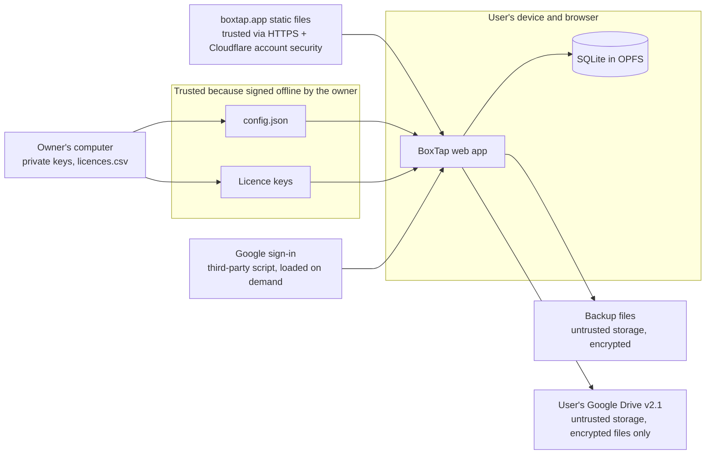

# BoxTap — Security Model (v2.1, web app, manual keys, Google Drive backup)

## 1. Trust boundaries

Two separate questions:
1. **Protecting the user's data** from other people. The device and browser are on the user's side.
2. **Protecting paid features** from users who don't pay. The browser is fully in the user's hands, so this protection is a deterrent, not a lock.

A third risk is new with a web app: **whoever controls the website controls the app code**. Securing the owner's Cloudflare and GitHub accounts is therefore as important as anything in the app.

## 2. Protecting user data

| Threat | Control | Residual |
| --- | --- | --- |
| Lost or stolen locked phone | Device encryption by the OS (Fact for modern Android and iOS) | Low |
| Someone using the unlocked device | Optional app lock PIN (screen lock only, ADR-019) | **Medium** |
| Other websites reading BoxTap data | Browser same-origin isolation | Low |
| Backup file leaked from Drive/iCloud/email | AES-256-GCM; key wrapped by Argon2id of a 12-word code | Low |
| Browser or iOS deletes site data | Persistent-storage request; iPhone install required before much data; weekly backup banner | **Medium** |
| User clears browser data or deletes the iPhone icon | Onboarding warning; backup banner; "last backup" date on the home screen | **Medium: user responsibility** |
| Malicious QR codes | Only `boxtap.app/b/<10 valid chars>` is accepted by the scanner | Low |
| Injection via item names into PDFs/images | Drawn as text (pdf-lib, Canvas), never as HTML; React escaping in the UI | Low |
| Tampered app code via the website (account takeover) | 2FA (hardware key or app) on Cloudflare and GitHub; branch protection on `main`; deploys only from CI; Subresource Integrity not needed (all code is same-origin) | Low if 2FA is kept |
| Third-party scripts stealing data | **(v2.1) One third-party script: Google's sign-in library**, injected only after the user taps "Connect Google Drive" and never on the first screen. CSP **(audit B1)**: `default-src 'self'`; `script-src 'self' 'wasm-unsafe-eval' https://accounts.google.com/gsi/client` (`'wasm-unsafe-eval'` is required to compile SQLite, Argon2id and zxing WebAssembly; `'unsafe-eval'` is never allowed); `worker-src 'self'`; `img-src 'self' blob: data:` (photo blobs and QR images); `frame-ancestors 'none'`; `base-uri 'none'`; `X-Content-Type-Options: nosniff`; `style-src 'self' https://accounts.google.com/gsi/style`; `frame-src https://accounts.google.com`; `Cross-Origin-Opener-Policy: same-origin-allow-popups` (never `same-origin`, which breaks the Google pop-up; audit fix A8); `connect-src 'self' https://accounts.google.com https://oauth2.googleapis.com https://www.googleapis.com`. No other third-party code | Low–Medium (we trust Google's script) |
| **(v2.1)** Google Drive account taken over, or folder shared by mistake | Every file encrypted on the device (AES-256-GCM, backup key wrapped by Argon2id of the 12-word code); random file names; no item text in metadata | Low |
| **(v2.1)** Access token stolen (e.g. by a script bug) | Token in memory only, about 1 h life; scope `drive.file` reaches only BoxTap's own files, which are encrypted; strict CSP, no `innerHTML` with user data | Low |
| **(v2.1)** Token left in the address bar or history after redirect sign-in | Fragment read and cleared with `history.replaceState` before any other code runs; `/oauth` is a tiny static `oauth.html` excluded from the service worker's navigation fallback (audit B17), loads no other scripts and hands the token to the app by `BroadcastChannel`; `Referrer-Policy: no-referrer` | Low |
| **(audit B17)** Attacker's token injected through a crafted `/oauth#access_token=…` link, so the victim's backups upload to the attacker's Drive | Redirect carries a random `state` kept in `sessionStorage`; a fragment is accepted only while a redirect is pending and `state` matches; the token's audience is checked against the client ID (tokeninfo) before use | Low |
| **(v2.1)** Someone restores the user's backup on their own device | Needs the Google sign-in **and** the 12-word code | Low |
| **(v2.1)** User loses phone **and** recovery code | Drive files cannot be decrypted by anyone, including the owner (by design). Onboarding asks the user to write the code down (or print the recovery sheet) and confirm 3 words. **Audit B7: the code is never stored on the device**, so there is no "Show recovery code". Settings offers "Change recovery code" (asks for the old code, re-wraps the key, cheap) and "New recovery code" if the old one is lost (new key, everything re-encrypted, old-key files deleted from Drive after the re-upload) | **Medium: user responsibility** |

**Privacy:** BoxTap collects no personal data on any server. The only network calls are loading the app and the config file, and, **(v2.1)** if the user connects Drive, Google sign-in and the user's own Drive. The owner never receives Google tokens, emails or files. Cloudflare sees IP addresses for those requests (standard hosting logs). Payments are handled by Stripe/bKash under their policies; the owner keeps `licences.csv` with buyer names/emails, which must be stored privately and only as long as needed for tax records (Assumption: confirm with an accountant). Privacy policy in English and Bangla; Bangla consent screen for Seller mode (N-09).

## 3. Protecting paid features

| Threat | Control | Residual |
| --- | --- | --- |
| Forged licence key | Ed25519 signature; private key never online | Low |
| Key shared with friends | Licensee name shown in Settings; revocation list in config; each key's use is visible to its owner | **Medium** (keys are not device-bound by design) |
| Old config with higher limits | Monotonic `seq` | Low |
| Device clock set backwards | `trustedNow()` high-water mark | Low–Medium |
| Editing browser storage or app code (developer tools) to skip `can()` | None fully effective in a browser (Fact). Minified code; checks in a few places; nothing else | **High likelihood for technical users, low for normal users. Accepted** given A$12.95 / ৳199 prices |
| Never fetching config again (to dodge revocation) | Revocation needs a fetch; expiry does not | Medium, accepted |

If misuse becomes noticeable, the upgrade path is the small licence service (PWA_PROPOSAL Option A), which can make keys single-device and check them online now and then.

## 4. Key management

| Key | Purpose | Storage | If lost | If leaked |
| --- | --- | --- | --- | --- |
| Config key `cfg-YYYY` | Signs `config.json` | Owner's computer (encrypted file) + password manager + printed copy | Ship an app update with a new public key | Same, plus `kid` deny-list in the new app version |
| Licence key `lic-YYYY` | Signs licence keys | Same, separate file | Existing keys keep working; ship new public key for new ones | New app version distrusts that `kid` except for a list of SHA-256 hashes of known good **full signed keys** (not key IDs, which a key thief could reuse; audit B18) |
| Cloudflare account | Website and app code | 2FA, recovery codes offline | Cloudflare recovery | Rotate credentials; redeploy from GitHub |
| GitHub account | Source code, CI | 2FA, branch protection | GitHub recovery | Same |
| Stripe account | Payments | 2FA | Stripe support | Rotate; check payouts |
| **(v2.1)** Google Cloud project (OAuth client) | Lets BoxTap ask users for Drive access | 2FA on the owner's Google account; owner + one backup admin | Google account recovery. **Audit B4: never delete or replace this client.** `drive.file` access belongs to the OAuth client, so a new client ID **cannot see any existing user backup** (Fact). Protection: the project sits in a Google Cloud organisation or has two owner accounts with 2FA; deletion is protected. Last resort if it is lost anyway: users download their `BoxTap Backup` folder from the Drive website and use "Restore from downloaded backup files" (API_CONTRACTS §6.2), then connect again | Client ID is public by design; an attacker can't use it from another website because only `https://boxtap.app` is an authorised origin. **Preview deployments use a separate test OAuth client** with a fixed branch alias, so a preview can never reach production users' files (audit B4) |
| **(v2.1)** User backup key | Encrypts Drive and file backups | Device: non-extractable WebCrypto key in IndexedDB; the wrapped copy made once at setup is carried in every file (API_CONTRACTS §6, A2). Each file header names the key's `key_id` (audit B7) | Restore with the recovery code | Only with the device unlocked and the browser open; rotate by "New recovery code": everything re-encrypted, then every Drive file with the old `key_id` deleted; exported `.btbak` files stay readable with the old code (user is told) |

Recommendation: the app ships with **current and next year's** public keys so yearly rotation needs no emergency release.

## 5. Pre-launch checklist

- [ ] Content Security Policy and other security headers set in Cloudflare Pages `_headers`, **and E2E tests run against `wrangler pages dev` so `_headers` is really applied** (the Vite dev server ignores it; audit B1)
- [ ] No third-party scripts or fonts at runtime **except** Google sign-in, loaded only on "Connect Google Drive" (v2.1)
- [ ] (v2.1) Google OAuth consent screen: app name, logo, `boxtap.app` verified, privacy policy and terms links; only `drive.file` requested; published to production
- [ ] 2FA on Cloudflare, GitHub, Stripe; branch protection on `main`
- [ ] Private keys outside the repository; CI secret scan blocks private-key patterns
- [ ] Backup crypto tested with known-answer vectors; restore tested across browsers
- [ ] (v2.1) Privacy policy explains Drive use and follows Google's API Services User Data Policy (Limited Use)
- [ ] (v2.1) No Drive file name, description or property contains user text; token never written to storage (automated test)
- [ ] Privacy policy (EN/BN) live; onboarding warns about clearing browser data
