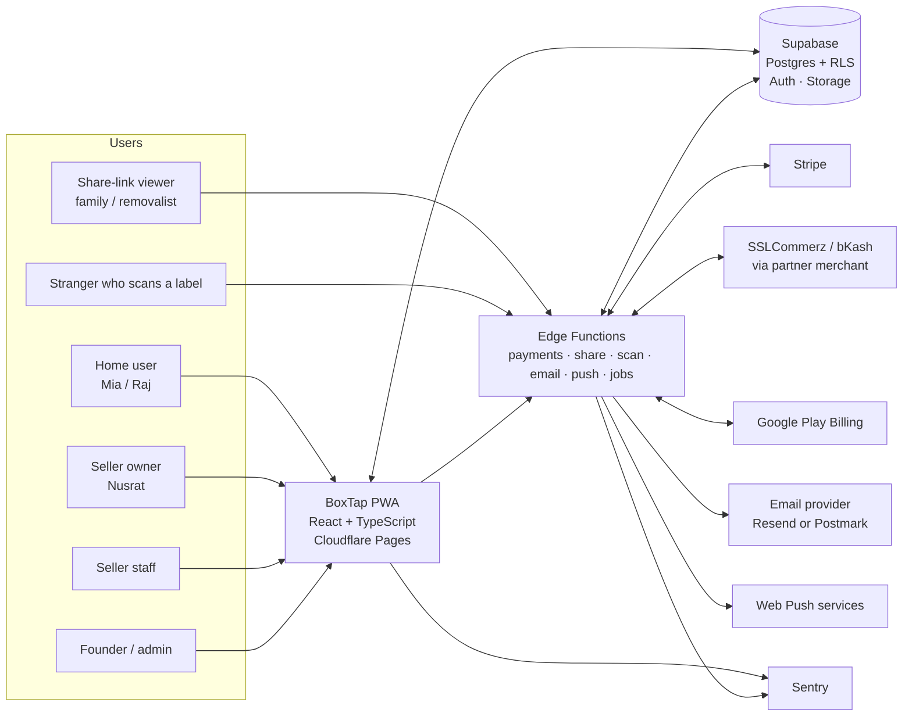
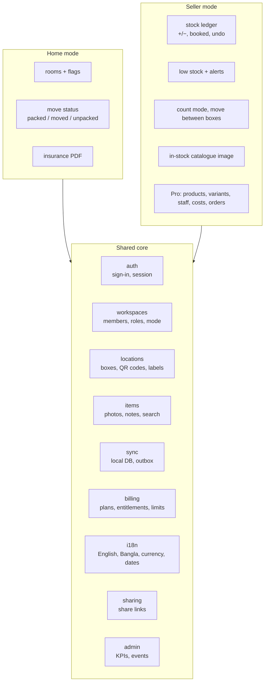
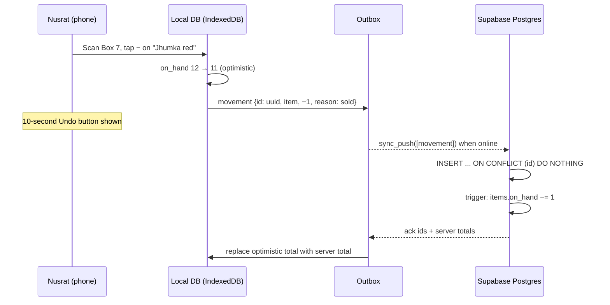
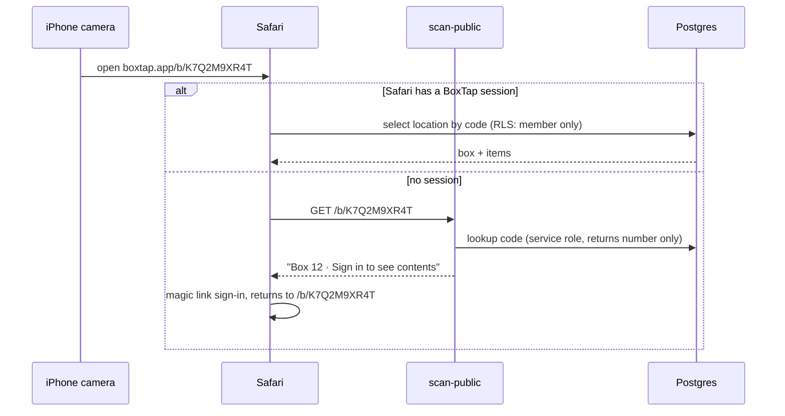
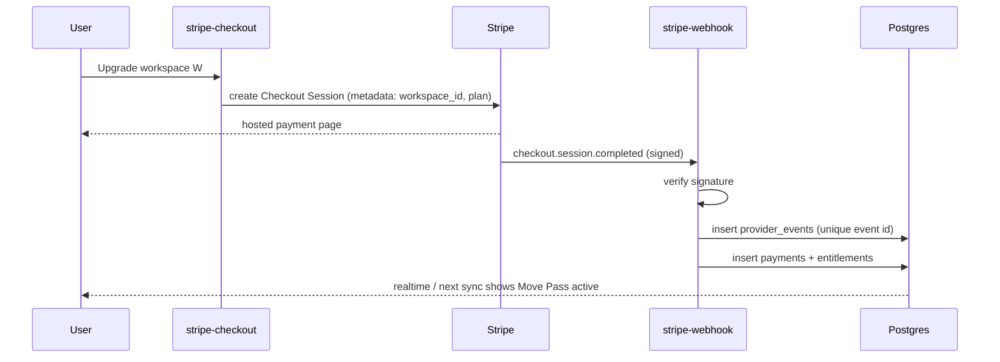

# BoxTap — System Architecture

Version 0.2 · 2026-11-23 · Based on *BoxTap 2-in-1 App Requirements* (2026-11-22), the gap review, and the "How BoxTap Works" whiteboard.
Decisions are recorded in [ADR.md](ADR.md). Labels: **Fact**, **Assumption**, **Recommendation**, **Open decision**.

## 1. Summary

BoxTap is a **modular monolith**: one React PWA, one Supabase Postgres database protected by row-level security, and about eight small Edge Functions for anything that needs a secret. Home and Seller are **modes of one app**, not two apps: they share accounts, workspaces, locations, items, photos, labels, search, billing and sync; Seller adds a stock ledger on top.

Estimated running cost at launch: about **US$30–40/month** (Supabase Pro US$25, everything else on free tiers) — Assumption, re-check pricing before launch.

## 2. Context diagram

## 3. Module boundaries

The frontend and the database are both split into the same modules. A mode module may depend on core modules; core modules never depend on a mode module.

| Module | Owns (tables) | Main screens | Phase |
| --- | --- | --- | --- |
| auth | `profiles` | Sign up, sign in, magic link | 1 |
| workspaces | `workspaces`, `members` | Workspace switcher, settings | 1 (single), 2 (multi) |
| locations | `locations`, `label_batches` | Box list, box page, label print | 1 |
| items | `items`, `photos` | Add items, photo capture, search | 1 |
| sync | client only (IndexedDB) + `sync_push` / `sync_pull` RPCs | — | 1 (read cache), 2 (outbox) |
| billing | `payments`, `entitlements`, `provider_events` | Upgrade, receipts | 1b (Stripe), 3 (BD, Play) |
| sharing | `share_links` | Share sheet, shared view | 1b |
| i18n | language files | Language picker | 2 |
| admin | `events`, views | Admin dashboard | 1 |
| home | `rooms`, location flags/status | Rooms, arrival check | 1 / 1b |
| stock | `stock_movements`, item stock columns | Scan tiles, history | 2 |
| seller-pro | `products`, `variants`, `item_costs`, `orders`, `push_subscriptions` | Pro screens | 3 |

## 4. Frontend architecture

| Concern | Choice | Why |
| --- | --- | --- |
| Framework | React 18 + TypeScript + Vite | Large ecosystem; coding agents know it well |
| Routing | React Router | Routes: `/w/:workspaceId/...`, `/b/:code` |
| Server state | TanStack Query on top of the local DB | Caching, retries, background refresh |
| Local DB | Dexie (IndexedDB) | Offline view (C-09) and outbox (S-11) |
| Forms | React Hook Form + Zod | One Zod schema per form, shared with RPC input types |
| UI | Tailwind CSS + headless components | Small bundle for cheap Android phones |
| Offline shell | Workbox service worker | Caches the app shell and opened box pages |
| QR scan | BarcodeDetector → `zxing-wasm` fallback | Native speed on Android Chrome; works on iOS |
| PDF/labels | `pdf-lib` + `qrcode` | Generated on the phone (ADR-010) |
| Images | `browser-image-compression` → WebP, 1600 px long edge (~200 KB) + 400 px thumbnail | C-10, N-11 |
| Search | MiniSearch over local data | Offline, typo-tolerant (ADR-011) |
| i18n | i18next, JSON files `en.json`, `bn.json`; Noto Sans Bengali subset, self-hosted | C-12, N-04 |
| Numbers/dates | `Intl.NumberFormat` / `Intl.DateTimeFormat` with `en-AU` or `bn-BD` | N-05; Bangla digits optional (S-26) |
| Errors | Sentry browser SDK, PII scrubbing on | Fast bug finding |

**Performance budget (Recommendation):** first load ≤ 200 KB JS gzipped; box page from local cache in < 300 ms; +/− tap writes locally in < 50 ms and shows the new number immediately (N-02).

**Accessibility:** 44 px touch targets, WCAG AA contrast, stock state shown by colour **and** word (N-06).

## 5. Backend architecture

### 5.1 Where logic lives

| Layer | What goes there | Example |
| --- | --- | --- |
| Postgres constraints | Data shape that must never break | `quantity` integer, unique `code`, FK to workspace |
| RLS policies | Who can see/change which rows | Member of workspace only |
| Triggers | Derived values and limits | Update `on_hand` after a movement; plan box limit |
| RPC functions (`SECURITY INVOKER` unless noted) | Multi-row business actions | `sync_push`, `move_stock`, `create_label_batch` |
| Edge Functions | Secrets, third parties, public endpoints | Stripe webhook, signed-out scan, share view, emails |
| Scheduled jobs (`pg_cron` → Edge Function) | Daily/nightly work | Pass expiry emails, ledger reconciliation, purge deleted accounts |

### 5.2 Edge Functions

| Function | Trigger | Auth | Phase |
| --- | --- | --- | --- |
| `scan-public` | `GET /b/:code` when no session | None, rate-limited | 1 |
| `share-view` | `GET /s/:token` | Token | 1b |
| `stripe-checkout` | User taps Upgrade | User JWT | 1b |
| `stripe-webhook` | Stripe | Signature | 1b |
| `bd-payment-init` / `bd-payment-ipn` | User / SSLCommerz | JWT / IPN + validation call | 3 |
| `play-rtdn` | Google Pub/Sub push | Google-signed token | 3 |
| `jobs-daily` | `pg_cron` 02:00 AEST | Service secret | 1b |
| `push-low-stock` | After movement batch / cron | Service secret | 3 |
| `account-delete` | User request | User JWT + re-auth | 1 |

### 5.3 Key flows

**Seller sells one piece (online or offline):**

**Home user scans a label with the iPhone camera:**

**Payment confirms a plan:**

## 6. Infrastructure and environments

| Environment | Frontend | Backend | Data |
| --- | --- | --- | --- |
| Local | `vite dev` | `supabase start` (Docker) | Seed script with sample Home + Seller workspaces |
| Staging | Cloudflare Pages preview per branch | Supabase project `boxtap-staging` | Test data; Stripe test mode |
| Production | Cloudflare Pages `boxtap.app` | Supabase project `boxtap-prod`, Pro plan, Sydney | Daily backups (Fact: included in Pro); PITR optional add-on |

**CI/CD (GitHub Actions):** on every PR — typecheck, lint, unit tests, database tests (pgTAP for RLS and triggers against a local Supabase), Playwright smoke tests, migration dry run. On merge to `main` — deploy frontend; apply migrations to staging. Production migrations are applied manually with a checklist (backup confirmed, rollback script ready).

**Monitoring:** Sentry (frontend + functions), Supabase logs, a daily `jobs-daily` health email to the founder (ledger mismatches, failed webhooks, error count), and uptime checks on `/b/health`.

**Backups and recovery:** daily Supabase backups; weekly restore test into staging (N-10); photos in Storage are not included in database backups (Fact) — a weekly job copies new photos to a second bucket or to Cloudflare R2 (Recommendation).

**Secrets:** only in Supabase function secrets and GitHub Actions secrets. The frontend holds only the public anon key and URL.

## 7. Web and mobile integration

- One codebase serves desktop browsers, Android Chrome, iPhone Safari and (Phase 3) the Play Store wrapper.
- Push notifications: Web Push with VAPID keys. Works in Android Chrome; on iPhone only for installed home-screen apps on iOS 16.4+ (Fact). Low-stock alerts therefore also appear as an in-app list and badge.
- Camera: requested only when the person taps Scan or Add photo; denial shows a "type the box number" fallback.
- Offline: see [DATABASE_SCHEMA.md §6](DATABASE_SCHEMA.md#6-offline-sync-protocol).

## 8. Requirement traceability (summary)

| Requirement | Covered by |
| --- | --- |
| C-01 sign-up < 2 min | Supabase Auth email+password / magic link; mode chosen on one screen |
| C-02 workspaces never mix | `workspace_id` on every row + RLS + local DB partitioned by workspace |
| C-04/C-05 private QR | 10-char random code; `scan-public` returns number only |
| C-07 search < 1 s | Local MiniSearch + server `pg_trgm` |
| C-09 offline view | Dexie cache + Workbox |
| C-11 billing, server-enforced limits | ADR-008 + limit triggers |
| C-13 export / delete | `export_workspace` RPC → CSV on phone; `account-delete` |
| H-05 share link revoke at once | Token checked on every request; no caching of shared views |
| H-06 never lose data | Entitlement end only blocks *new* boxes/photos, never reads |
| S-03 totals = history | ADR-004 trigger + nightly reconciliation |
| S-11 offline, no double count | ADR-005 idempotent outbox |
| N-07 security | [SECURITY_MODEL.md](SECURITY_MODEL.md) |
| Gaps G1–G12 | Photo-first box, in-app scanner, booked stock, `spot`, label reassign, `alt_name`, removalist scope |
