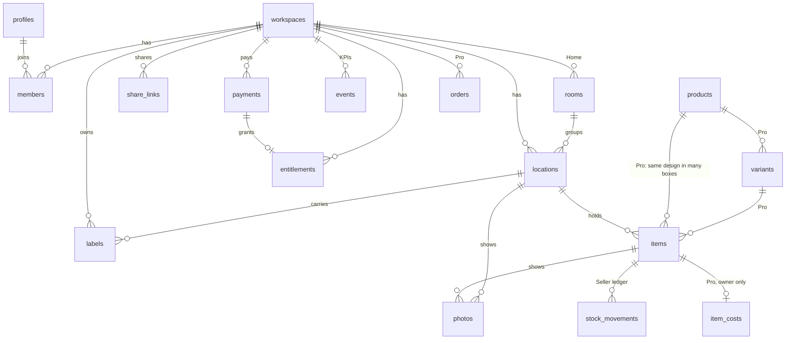

# BoxTap — Database Schema

Postgres 15 on Supabase. Every business table carries `workspace_id`. Access is enforced by row-level security (RLS) and column grants; see [SECURITY_MODEL.md](SECURITY_MODEL.md). Decisions: [ADR.md](ADR.md) (ADR-004, 005, 006, 009, 013).

## 1. Entity relationships



## 2. Conventions

- Primary keys: `uuid`. IDs for rows created offline (items, locations, photos, movements) are generated **on the phone** (UUID v7, time-ordered) so the outbox is idempotent.
- Every business table has `created_at`, `updated_at`, and `change_seq bigint` (set from one global sequence by trigger) so `sync_pull` can fetch "everything changed since N".
- Soft delete: `deleted_at timestamptz`. A daily job hard-deletes rows deleted more than 30 days ago (C-03 30-day bin).
- **Composite foreign keys** `(workspace_id, x_id)` → `(workspace_id, id)` on every child table. This makes it impossible to attach an item in workspace A to a box in workspace B, even with a crafted request.
- Money: `numeric(12,2)` plus the workspace's `currency`. Payment amounts: `bigint` minor units.

## 3. Phase 1 to 2 tables (DDL)

```sql
create extension if not exists pg_trgm;
create extension if not exists pgcrypto;

create sequence change_seq;

create type workspace_type as enum ('home', 'seller');
create type member_role   as enum ('owner', 'staff');
create type location_kind as enum ('box', 'tub', 'drawer', 'shelf', 'bag', 'other');
create type move_status   as enum ('packed', 'moved', 'unpacked');
create type stock_reason  as enum ('sold','restock','count','damaged','returned','moved_in','moved_out',
                                   'booked','unbooked','shipped','undo','opening');

create table profiles (
  id          uuid primary key references auth.users(id) on delete cascade,
  display_name text check (char_length(display_name) <= 80),
  language    text not null default 'en' check (language in ('en','bn')),
  created_at  timestamptz not null default now()
);

create table workspaces (
  id          uuid primary key default gen_random_uuid(),
  owner_id    uuid not null references profiles(id),
  type        workspace_type not null,
  name        text not null check (char_length(name) between 1 and 80),
  country     text not null check (country in ('AU','BD')),
  currency    text not null check (currency in ('AUD','BDT')),
  is_pilot    boolean not null default false,          -- S-09: no limits, no payment
  created_at  timestamptz not null default now(),
  updated_at  timestamptz not null default now(),
  deleted_at  timestamptz,
  change_seq  bigint not null default nextval('change_seq')
);

create table members (
  workspace_id uuid not null references workspaces(id) on delete cascade,
  user_id      uuid not null references profiles(id) on delete cascade,
  role         member_role not null,
  created_at   timestamptz not null default now(),
  primary key (workspace_id, user_id)
);
create index on members (user_id);

create table rooms (                                   -- Home only
  id           uuid primary key,
  workspace_id uuid not null references workspaces(id) on delete cascade,
  name         text not null check (char_length(name) between 1 and 60),
  colour       text not null default 'blue',
  sort_order   int  not null default 0,
  updated_at   timestamptz not null default now(),
  deleted_at   timestamptz,
  change_seq   bigint not null default nextval('change_seq'),
  unique (workspace_id, id)
);

create table locations (                               -- a box, tub, drawer...
  id           uuid primary key,
  workspace_id uuid not null references workspaces(id) on delete cascade,
  number       int  check (number > 0),             -- allocated by the server (audit D4); null until the box syncs
  name         text check (char_length(name) <= 80),
  kind         location_kind not null default 'box',
  room_id      uuid,
  spot         text check (char_length(spot) <= 80),   -- gap G5: "garage, top shelf"
  colour       text,
  is_fragile   boolean not null default false,
  open_first   boolean not null default false,
  move_status  move_status,                            -- gap: arrival check (Home)
  notes        text check (char_length(notes) <= 2000),
  created_by   uuid references profiles(id),
  created_at   timestamptz not null default now(),
  updated_at   timestamptz not null default now(),
  deleted_at   timestamptz,
  change_seq   bigint not null default nextval('change_seq'),
  unique (workspace_id, id),
  unique (workspace_id, number),
  foreign key (workspace_id, room_id) references rooms (workspace_id, id)
);

-- A label is a QR code. Separate from the box so a torn label can be replaced
-- and a spare label attached (gap G6). Scanning resolves code -> location.
create table labels (
  code         text primary key check (code ~ '^[0-9A-HJKMNP-TV-Z]{10}$'), -- Crockford base32, ~50 bits
  workspace_id uuid not null references workspaces(id) on delete cascade,
  location_id  uuid,                                   -- null = printed spare, not yet attached
  created_at   timestamptz not null default now(),
  retired_at   timestamptz,
  foreign key (workspace_id, location_id) references locations (workspace_id, id)
);
create index on labels (workspace_id, location_id);

create table items (
  id              uuid primary key,
  workspace_id    uuid not null references workspaces(id) on delete cascade,
  location_id     uuid not null,
  product_id      uuid,                                -- Phase 3
  variant_id      uuid,                                -- Phase 3
  name            text not null check (char_length(name) between 1 and 120),
  alt_name        text check (char_length(alt_name) <= 120),   -- gap G8: Bangla / Banglish
  notes           text check (char_length(notes) <= 2000),
  value_estimate  numeric(12,2) check (value_estimate >= 0),   -- Home insurance PDF (optional)
  -- Seller stock (cached from stock_movements; clients cannot write these columns)
  on_hand         int not null default 0,
  reserved        int not null default 0,              -- may dip below 0 after offline conflicts; UI flags it
  low_stock_level int check (low_stock_level >= 0),
  sale_price      numeric(12,2) check (sale_price >= 0),
  -- jewellery fields, optional (ADR-012)
  pricing_mode    text not null default 'per_piece' check (pricing_mode in ('per_piece','by_weight')),
  weight_grams    numeric(9,3) check (weight_grams > 0),
  purity          text check (char_length(purity) <= 20),          -- 22K, 21K, 18K, 925 silver...
  making_charge   numeric(12,2) check (making_charge >= 0),
  created_at      timestamptz not null default now(),
  updated_at      timestamptz not null default now(),
  deleted_at      timestamptz,
  change_seq      bigint not null default nextval('change_seq'),
  unique (workspace_id, id),
  foreign key (workspace_id, location_id) references locations (workspace_id, id)
);
create index items_search_trgm on items
  using gin ((coalesce(name,'') || ' ' || coalesce(alt_name,'') || ' ' || coalesce(notes,'')) gin_trgm_ops);
create index on items (workspace_id, location_id) where deleted_at is null;
create index items_low_stock on items (workspace_id)
  where deleted_at is null and low_stock_level is not null and on_hand - reserved <= low_stock_level;

create table photos (
  id           uuid primary key,
  workspace_id uuid not null references workspaces(id) on delete cascade,
  location_id  uuid,
  item_id      uuid,
  storage_path text not null,            -- workspaces/{workspace_id}/{photo_id}.webp
  thumb_path   text not null,
  bytes        int  not null check (bytes between 1 and 600000),
  created_at   timestamptz not null default now(),
  deleted_at   timestamptz,
  change_seq   bigint not null default nextval('change_seq'),
  check ((location_id is null) <> (item_id is null)),
  foreign key (workspace_id, location_id) references locations (workspace_id, id),
  foreign key (workspace_id, item_id)     references items     (workspace_id, id)
);

-- Seller ledger. Insert-only. id generated on the phone.
create table stock_movements (
  id              uuid primary key,
  workspace_id    uuid not null,
  item_id         uuid not null,
  on_hand_delta   int  not null,
  reserved_delta  int  not null default 0,
  reason          stock_reason not null,
  reverses_id     uuid references stock_movements(id),
  user_id         uuid not null references profiles(id),
  device_id       uuid not null,
  happened_at     timestamptz not null,         -- phone clock, for display
  received_at     timestamptz not null default now(),  -- server clock, for ordering
  note            text check (char_length(note) <= 200),
  foreign key (workspace_id, item_id) references items (workspace_id, id),
  check (on_hand_delta <> 0 or reserved_delta <> 0),
  check (abs(on_hand_delta) <= 100000 and abs(reserved_delta) <= 100000),
  check (case reason
    when 'sold'      then on_hand_delta < 0 and reserved_delta = 0
    when 'damaged'   then on_hand_delta < 0 and reserved_delta = 0
    when 'moved_out' then on_hand_delta < 0 and reserved_delta = 0
    when 'restock'   then on_hand_delta > 0 and reserved_delta = 0
    when 'returned'  then on_hand_delta > 0 and reserved_delta = 0
    when 'moved_in'  then on_hand_delta > 0 and reserved_delta = 0
    when 'opening'   then on_hand_delta > 0 and reserved_delta = 0
    when 'booked'    then on_hand_delta = 0 and reserved_delta > 0
    when 'unbooked'  then on_hand_delta = 0 and reserved_delta < 0
    when 'shipped'   then on_hand_delta < 0 and reserved_delta = on_hand_delta
    else true                                   -- 'count', 'undo'
  end),
  check ((reason = 'undo') = (reverses_id is not null))
);
create index on stock_movements (workspace_id, item_id, received_at desc);
create unique index one_undo_per_movement on stock_movements (reverses_id) where reverses_id is not null;

create table share_links (
  id           uuid primary key default gen_random_uuid(),
  workspace_id uuid not null references workspaces(id) on delete cascade,
  token_hash   bytea not null unique,            -- sha256 of a 22-char random token; token itself never stored
  scope        text not null check (scope in ('family','removalist','catalogue')),
  location_ids uuid[],                           -- null = whole workspace
  expires_at   timestamptz,
  revoked_at   timestamptz,
  created_by   uuid not null references profiles(id),
  created_at   timestamptz not null default now()
);

create table provider_events (                   -- webhook idempotency
  provider    text not null check (provider in ('stripe','sslcommerz','bkash','play')),
  event_id    text not null,
  received_at timestamptz not null default now(),
  payload     jsonb not null,
  processed_at timestamptz,
  primary key (provider, event_id)
);

create table payments (
  id            uuid primary key default gen_random_uuid(),
  workspace_id  uuid not null references workspaces(id),
  provider      text not null,
  provider_ref  text not null,
  amount_minor  bigint not null check (amount_minor >= 0),
  currency      text not null,
  status        text not null check (status in ('paid','refunded','failed','disputed')),
  created_at    timestamptz not null default now(),
  unique (provider, provider_ref)
);

create table entitlements (
  id           uuid primary key default gen_random_uuid(),
  workspace_id uuid not null references workspaces(id),
  plan         text not null check (plan in ('move_pass','seller_pro')),
  payment_id   uuid references payments(id),
  starts_at    timestamptz not null,
  ends_at      timestamptz not null,
  status       text not null default 'active' check (status in ('active','revoked')),
  check (ends_at > starts_at)
);
create index on entitlements (workspace_id, ends_at desc);

create table events (                             -- KPIs (C-14); no personal data in props
  id           bigint generated always as identity primary key,
  workspace_id uuid references workspaces(id) on delete set null,
  user_id      uuid references profiles(id) on delete set null,
  name         text not null check (name ~ '^[a-z_]{3,40}$'),
  props        jsonb not null default '{}' check (pg_column_size(props) < 2000),
  created_at   timestamptz not null default now()
);
create index on events (name, created_at);
```

## 4. Phase 3 tables (outline)

```sql
create table products (id uuid primary key, workspace_id uuid not null, name text not null,
  alt_name text, sku_prefix text, photo_id uuid, unique (workspace_id, id), ...);
create table variants (id uuid primary key, workspace_id uuid not null, product_id uuid not null,
  colour text, size text, sku text, unique (workspace_id, sku), ...);
create table item_costs (item_id uuid primary key, workspace_id uuid not null,
  cost_price numeric(12,2) not null check (cost_price >= 0),
  foreign key (workspace_id, item_id) references items (workspace_id, id));   -- owner-only RLS (ADR-009)
create table orders (id uuid primary key, workspace_id uuid not null, label text,
  status text check (status in ('booked','packed','shipped','returned','cancelled')), ...);
create table order_lines (order_id uuid, item_id uuid, qty int check (qty > 0), ...);
create table push_subscriptions (id uuid primary key, user_id uuid not null, endpoint text unique,
  p256dh text, auth text, created_at timestamptz);
```
Migration from Phase 2: create a `products` row per distinct item name per workspace and set `items.product_id`. Additive only; no ledger change (ADR-006).

## 5. Triggers and functions

### 5.1 Stock totals (ADR-004)

```sql
create function apply_stock_movement() returns trigger
language plpgsql security definer set search_path = '' as $$
begin
  update public.items
     set on_hand  = on_hand  + new.on_hand_delta,
         reserved = reserved + new.reserved_delta,
         updated_at = now(),
         change_seq = nextval('public.change_seq')
   where id = new.item_id and workspace_id = new.workspace_id;
  return new;
end $$;

create trigger stock_movements_apply after insert on stock_movements
  for each row execute function apply_stock_movement();
```
`on_hand` may go below zero after two offline phones sell the last piece, and `reserved` may go below zero if two phones both tap Packed for one booking. Neither is clamped, so cached totals always equal the ledger sums. The UI shows such an item as **"Check stock"** and the owner fixes it with a `count` movement (ADR-005).

A `BEFORE INSERT` trigger `validate_stock_movement` also checks: the workspace is a Seller workspace; `user_id = auth.uid()` (or the service role); for `reason = 'undo'`, the deltas are exactly the negatives of the reversed movement, which belongs to the same item, is at most 24 hours old, and was made by the caller unless the caller is the owner (audit D7).

### 5.2 Plan limits (C-11, H-03, Seller Free 50 items)

```sql
create function workspace_limits(ws uuid)
returns table (max_boxes int, max_photos_per_parent int, max_items int)
language sql stable security definer set search_path = '' as $$
  select
    case when w.is_pilot or e.plan is not null then null
         when w.type = 'home' then 12 else null end,
    case when w.is_pilot then 5
         when e.plan = 'move_pass' then 5 when e.plan = 'seller_pro' then 5 else 1 end,
    case when w.type = 'seller' and not w.is_pilot and e.plan is null then 50 else null end
  from public.workspaces w
  left join lateral (select plan from public.entitlements
                      where workspace_id = w.id and status = 'active'
                        and now() between starts_at and ends_at
                      order by ends_at desc limit 1) e on true
  where w.id = ws;
$$;
```
A `BEFORE INSERT` trigger on `locations`, `items` and `photos` locks the workspace row (`select ... for update`) and counts non-deleted rows, so two simultaneous inserts cannot both slip past the limit. Over the limit → `raise exception 'plan_limit:<kind>'`, which the app turns into the upgrade screen. **Reads and edits are never blocked**, only new rows (H-06).

### 5.3 Other functions

| Function | Purpose |
| --- | --- |
| `set_change_seq()` trigger | Bumps `change_seq` and `updated_at` on every update |
| `create_workspace(type, name, country)` | Creates workspace + owner member in one transaction; allows one free workspace per type per account (audit D5) |
| `create_label_batch(ws, count, location_ids?)` | Generates unique codes server-side with `gen_random_bytes`; creates and numbers new boxes, or attaches codes to existing boxes; returns codes + numbers for PDF printing (audit D4) |
| `grant_entitlement(ws, plan, payment_id, months)` | Service role only; new pass starts at the later of now and the current pass end (audit D9) |
| `attach_label(code, location_id)` | Attach a spare label; optionally retire the old one |
| `move_stock(from_item, to_location, qty, ids[2])` | Two movements in one transaction; creates target item if needed (ADR-006) |
| `count_box(location_id, counts jsonb, ids[])` | Writes one `count` movement per changed item (S-07) |
| `export_workspace(ws)` | Returns JSON for CSV export (C-13) |
| `reconcile_stock()` | Nightly: compares `items.on_hand/reserved` with ledger sums; logs and alerts on mismatch |

## 6. Offline sync protocol

**Phone storage (Dexie):** one IndexedDB database per signed-in user; every table keyed by `workspace_id`, so switching workspace never shows another workspace's rows (C-02). Signing out clears it.

**Push (`sync_push`):**
```
sync_push(workspace_id, mutations: [{id, table, op, row, client_ts}]) -> {accepted: [id], rejected: [{id, code}], server_rows}
```
- `stock_movements`: `insert ... on conflict (id) do nothing` → retries are harmless.
- `locations`, `items`, `rooms`, `photos`: upsert by `id`; per-field last write wins by server receipt order; `on_hand`/`reserved` are ignored if sent.
- Each mutation is validated by RLS exactly as an online write would be. A rejected mutation (e.g. `plan_limit`, removed from workspace) stays visible on the phone with a clear message; it is never silently dropped. Mutations that depend on a rejected row are rejected with `parent_rejected` (audit D6).
- Boxes created offline get their number from the server on sync (audit D4).
- Batch size ≤ 200 mutations; the outbox sends in order, oldest first.

**Pull (`sync_pull`):**
```
sync_pull(workspace_id, since_seq) -> {rows by table, max_seq}
```
Returns rows with `change_seq > since_seq`, including soft-deleted ones (so the phone removes them). Because sequence numbers are taken before commit, the phone always re-asks from `since_seq − 1000` and upserts idempotently, and the server caps `max_seq` below any transaction still in progress (audit D3). If the caller is no longer a member, the server returns `not_member` and the phone deletes that workspace's local data (audit D10). Movements: last 30 days on free plans, full history on Pro.

**Photos offline:** stored as blobs in IndexedDB, uploaded when online to `workspaces/{ws}/{photo_id}.webp`, then the `photos` row is pushed. Upload uses the photo id as the object name, so a retry overwrites the same object rather than creating a duplicate.

## 7. Data lifecycle

| Data | Kept | Deleted |
| --- | --- | --- |
| Soft-deleted boxes/items | 30 days in bin | Hard delete by daily job; Seller items with movements stay archived for history (audit D8) |
| Stock movements | Life of workspace | With workspace |
| Deleted account | — | Workspaces they own, members rows, photos, profile: within 30 days; labels then resolve to "not linked" (C-13) |
| Payments | 7 years (tax records, Assumption — confirm with accountant) | Personal fields anonymised on account deletion |
| Events | 24 months | Rolled up to monthly counts |
