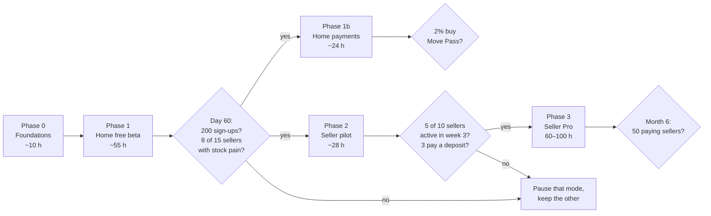

# BoxTap — Implementation Roadmap

Phases and checkpoints follow the requirements doc. Hours are the doc's estimates plus the gap-review additions (📐 estimates). **Nothing here authorises code changes yet; implementation starts only after the owner approves.**

## Phase 0 — Foundations (~10 h, week 1)

| Work | Acceptance |
| --- | --- |
| Repo, Vite + React + TS, Tailwind, ESLint, Vitest, Playwright | `npm test` and `npm run build` pass in CI |
| Supabase local + staging + prod projects; migrations folder | `supabase db reset` builds the schema from zero |
| CI pipeline incl. pgTAP and RLS-enabled check | A table without RLS fails CI |
| Sentry, Cloudflare Pages deploy, domain | Preview URL per branch |

## Phase 1 — Home free beta (~55 h, weeks 1–6)

Requirements: C-01, C-03–C-10, C-13, C-14, H-01–H-03 + gap fixes G1 (contents photo), G2 (in-app scanner), G5 (`spot`), G6 (labels table, reprint/attach).

| Step | Depends on | Acceptance |
| --- | --- | --- |
| 1. Auth + `create_workspace` (Home) | Phase 0 | Sign-up to first screen < 2 min on a phone |
| 2. Rooms, locations, labels, items, photos + RLS tests | 1 | Critical tests 1, 5 pass |
| 3. Photo capture + compression + upload | 2 | Upload < 5 s on 4G |
| 4. Label batch + PDF (L7165, L7163) | 2 | Print test passes on 3 printers |
| 5. Scan: in-app scanner, `/b/:code`, `scan-public` | 4 | Critical tests 2, 3 pass on iPhone and Android |
| 6. Search (local + server) | 2 | 400 items < 1 s |
| 7. PWA offline view | 2, 3 | Critical test 6 |
| 8. Free limits, export, delete account | 2 | Critical test 4 |
| 9. Admin KPIs + events | 1 | Weekly sign-ups and activation per mode visible |

## Phase 1b — Home payments (~24 h, weeks 7–10)

H-04–H-08, C-11 (Stripe), move status + arrival check, removalist scope (G11), one-tap Renew in reminder emails (ADR-014).
Acceptance: critical tests 7–11; test payment upgrades in < 10 s.

## Phase 2 — Seller pilot (~24 h, weeks 9–12)

C-02 (multi-workspace), C-12 basics, S-01–S-11, booked tap (G3, ADR-013), `alt_name` search (G8), optional jewellery fields (ADR-012), in-stock catalogue image (S-25, ADR-015). Estimate rises to ~28 h 📐.
Acceptance: critical tests 12–18; load test passes; a catalogue image shares to WhatsApp from a low-cost Android phone.

## Phase 3 — Seller Pro (60–100 h, from month 4, only if Phase 2 passes)

S-20–S-27: products/variants migration, item_costs, staff roles, Web Push, orders, full Bangla, Bangladesh payment route, Play Store TWA.
Acceptance: critical tests 19–20; payment provider replay tests; Play billing test purchase.

## Definition of done (every step)

Code reviewed, tests written and passing in CI, RLS tests for any new table, docs (`DATABASE_SCHEMA.md`, `API_CONTRACTS.md`) updated in the same PR, deployed to staging and checked on one real phone.
