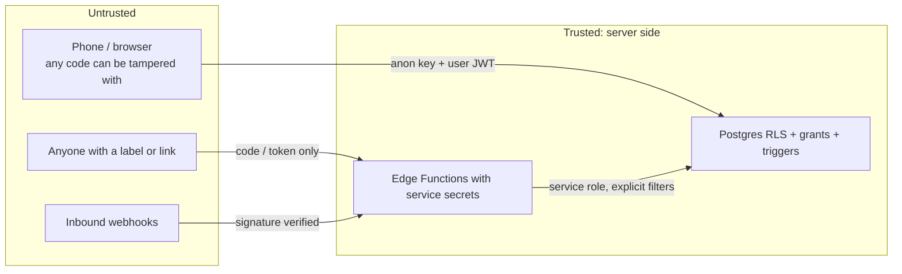

# BoxTap — Security Model

## 1. Trust boundaries



**Rule:** the phone is never trusted. Every limit, role and total is enforced in the database. Edge Functions that use the service role always filter by the workspace they resolved themselves, never by an id the caller sent.

## 2. Roles and permissions

| Action | Home owner | Seller owner | Seller staff (Pro) | Share-link viewer | Stranger scanning |
| --- | --- | --- | --- | --- | --- |
| See box number | ✓ | ✓ | ✓ | ✓ (in scope) | ✓ |
| See box contents and photos | ✓ | ✓ | ✓ | family: ✓ · removalist: ✗ (gap G11) | ✗ |
| Add / edit boxes and items | ✓ | ✓ | ✓ | ✗ | ✗ |
| +/− stock, booked, count | — | ✓ | ✓ | ✗ | ✗ |
| Undo own movement | — | ✓ | ✓ (own, 24 h) | ✗ | ✗ |
| See cost price, profit | — | ✓ | ✗ (ADR-009) | ✗ | ✗ |
| Delete boxes / items | ✓ (bin) | ✓ (bin) | ✗ | ✗ | ✗ |
| Manage members, billing, share links, export, delete workspace | ✓ | ✓ | ✗ | ✗ | ✗ |

## 3. RLS policies (core pattern)

```sql
create function is_member(ws uuid) returns boolean
language sql stable security definer set search_path = '' as $$
  select exists (select 1 from public.members
                 where workspace_id = ws and user_id = auth.uid());
$$;

create function is_owner(ws uuid) returns boolean
language sql stable security definer set search_path = '' as $$
  select exists (select 1 from public.members
                 where workspace_id = ws and user_id = auth.uid() and role = 'owner');
$$;

alter table items enable row level security;
create policy items_read   on items for select using (is_member(workspace_id));
create policy items_insert on items for insert with check (is_member(workspace_id));
create policy items_update on items for update using (is_member(workspace_id)) with check (is_member(workspace_id));
-- no DELETE policy: deletes are soft (deleted_at); staff cannot set deleted_at (column grant below)

revoke update on items from authenticated;
grant  update (name, alt_name, notes, value_estimate, low_stock_level, sale_price,
               pricing_mode, weight_grams, purity, making_charge, location_id, updated_at)
       on items to authenticated;
-- on_hand, reserved, deleted_at are not client-writable; soft delete goes through rpc soft_delete() which checks is_owner
revoke insert on items from authenticated;
grant  insert (id, workspace_id, location_id, name, alt_name, notes, value_estimate, low_stock_level, sale_price,
               pricing_mode, weight_grams, purity, making_charge)
       on items to authenticated;
-- a new item always starts at 0; opening stock is an 'opening' movement, so the ledger is complete from the first piece

alter table stock_movements enable row level security;
create policy sm_read   on stock_movements for select using (is_member(workspace_id));
create policy sm_insert on stock_movements for insert
  with check (is_member(workspace_id) and user_id = auth.uid());
revoke update, delete on stock_movements from authenticated, anon;

alter table item_costs enable row level security;
create policy costs_owner on item_costs for all using (is_owner(workspace_id)) with check (is_owner(workspace_id));
```

The same pattern applies to every table. `members`, `share_links`, `payments`, `entitlements`: read by owner only; written only by RPCs/Edge Functions. `provider_events`, `events` write: service role only (the app logs events through an RPC that fills `user_id` itself).

**Workspace creation** goes through `create_workspace(type, name, country)`, which inserts the workspace and the owner `members` row in one transaction. Direct inserts into `members` are not granted.

## 4. Threat model (STRIDE, condensed)

| # | Threat | Where | Control | Residual |
| --- | --- | --- | --- | --- |
| T1 | Guessing box codes to read contents | `/b/:code` | Codes are random 10-char base32 (~2^50); signed-out lookup returns only the box number; rate limit 30/min per IP, applied by a Cloudflare rate-limiting rule on the `/b/*` and `/s/*` routes in front of the Edge Functions (Supabase has no built-in per-IP limit for functions) | Low |
| T2 | Reading another workspace's data via a crafted request | REST/RPC | RLS on every table; composite FKs; automated RLS tests for every table and role | Low, if tests stay mandatory |
| T3 | Staff seeing cost prices | Seller Pro | Separate owner-only table (ADR-009) | Low |
| T4 | Forged "payment succeeded" | Billing | Plans set only from verified webhooks; event id unique; amount and currency checked against the plan price | Low |
| T5 | Leaked share link | Home | 22-char token, stored hashed, expiry default 30 days, one-tap revoke, removalist scope hides contents | Medium (links get forwarded) |
| T6 | Replay or duplicate sync batch | Offline | Client UUID primary keys, `on conflict do nothing` | Low |
| T7 | Malicious upload (huge or non-image file) | Storage | Bucket policy: path must start with a workspace the user belongs to; max 600 KB; MIME `image/webp|jpeg`; photos served only via signed URLs (1 h) | Low |
| T8 | Stolen or shared phone (Bangladesh family phone, gap G9) | Device | Sign-out clears IndexedDB; optional app PIN in Phase 3; owner can remove a staff member, which revokes access at the next request | Medium |
| T9 | Account takeover via email | Auth | Magic link expiry 1 h, single use; re-authentication before delete/export/billing changes; Supabase Auth rate limits | Medium (email is the weak point) |
| T10 | Scripted abuse of the free tier (storage costs) | Billing/Storage | Per-plan photo limits in triggers; daily storage report per workspace in admin | Low |
| T11 | XSS through item names or notes | Frontend | React escaping; no `dangerouslySetInnerHTML`; strict CSP on Cloudflare Pages; PDFs built from text, not HTML | Low |
| T12 | Secrets in the frontend | Build | Only anon key in the bundle; CI check fails the build if `service_role` or `sk_live` appears | Low |
| T13 | Webhook endpoint flooding | Edge Functions | Signature check first, before any database work | Low |

OWASP Top 10 coverage: A01 access control → RLS + tests; A02 crypto → TLS everywhere, hashed tokens; A03 injection → parameterised queries via PostgREST/RPC only; A04 insecure design → this threat model; A05 misconfiguration → RLS-enabled check in CI (`select tablename from pg_tables where rowsecurity = false` must return nothing in `public`); A07 auth → Supabase Auth; A08 integrity → webhook signatures; A09 logging → Sentry + `provider_events`; A10 SSRF → no user-supplied URLs fetched by the server.

## 5. Privacy

- **Australia:** plain-English privacy policy; export and delete in-app (C-13); follow the Australian Privacy Principles even if exempt (N-08).
- **Bangladesh:** explicit consent screen in Bangla at sign-up for Seller workspaces; Bangla privacy policy. Data is hosted in Sydney; the owner has confirmed no hosting rules apply (ADR-003).
- Data minimisation: no phone numbers, addresses or customer names are stored in Phase 1–2. Phase 3 orders store only a free-text order label (e.g. "Messenger – Rina"), and the seller is told not to enter phone numbers.
- Analytics events never contain item names, notes or photos.

## 6. Pre-launch security checklist

- [ ] RLS enabled on every `public` table (CI check)
- [ ] RLS test suite green for owner, staff, other user, anon on every table
- [ ] Storage bucket private; upload policy tested with a foreign workspace path
- [ ] Stripe webhook signature and replay test
- [ ] Rate limit on `scan-public` and `share-view` verified
- [ ] CSP header set; no inline scripts
- [ ] Secrets scan in CI
- [ ] Backup restore tested once into staging
