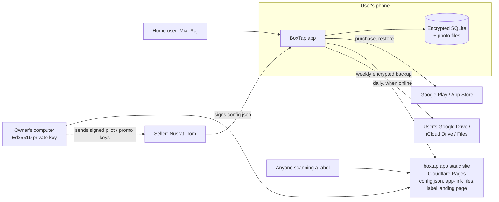
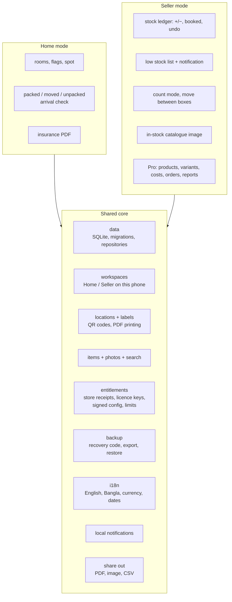
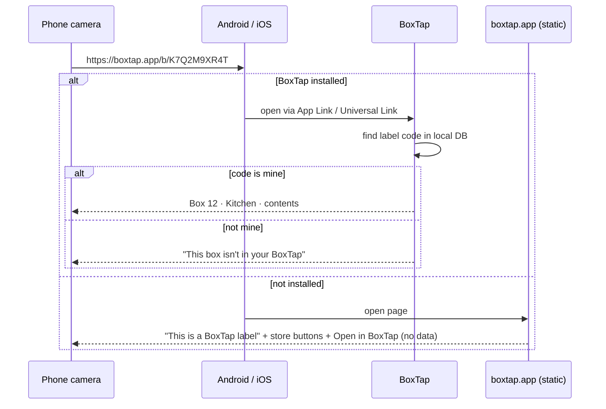
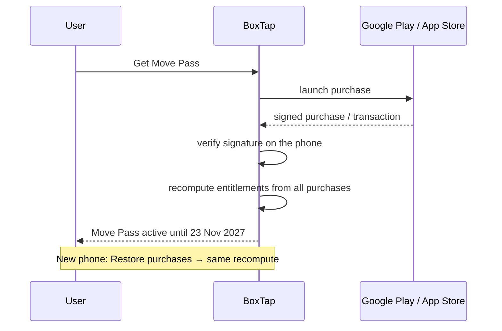

# BoxTap — System Architecture (v1.0, local-first)

Version 1.0 · 2026-11-23 · Based on the requirements doc (2026-11-22), the gap review, the owner's decisions, and the local-first choice made on 2026-11-23.
Decisions: [ADR.md](ADR.md). The earlier cloud design is in `archive/cloud-v0.2/`.

## 1. Summary

BoxTap is a **native app for Android and iPhone** (React + TypeScript inside Capacitor). Each user's boxes, items, photos and stock live in an **encrypted SQLite database on their phone**. There is **no backend database and no server code**. The owner controls money and features through **app-store billing** (verified on the phone), **signed licence keys** and a **signed config file** served from a free static website. Users keep their data safe with **encrypted backups to their own Google Drive or iCloud**.

Fixed running cost: about **US$115–130 a year** (Apple US$99/year, domain, Google's one-time US$25), plus 15% store commission on sales. Nothing grows with the number of users.

## 2. Context



**Nothing the user enters ever leaves the phone**, except inside backups the user controls (encrypted) and files the user chooses to share (PDF, images, CSV).

## 3. Module boundaries



Rules: mode modules may use core modules, never the other way round. Screens never touch SQL directly; they call repositories in `data`. Every premium check goes through one function, `can(feature)`, in `entitlements`.

| Module | Owns | Phase |
| --- | --- | --- |
| data | SQLite connection, encryption key, migrations, repositories | 0 |
| workspaces | `workspaces` | 1 (Home), 2 (Seller) |
| locations + labels | `rooms`, `locations`, `labels`, PDF labels, scanner | 1 |
| items | `items`, `photos`, FTS index | 1 |
| entitlements | `entitlements`, `licence_keys`, `app_config`, `time_guard` | 1 (free limits), 1b (billing) |
| backup | backup files, recovery code | 1 |
| share out | PDF/image/CSV via share sheet | 1b |
| stock | `stock_movements`, triggers | 2 |
| seller-pro | `products`, `variants`, `orders`, reports | 3 |

## 4. Technology

| Concern | Choice | Notes |
| --- | --- | --- |
| UI | React 18 + TypeScript + Vite, Tailwind | Planned screens reused |
| Native shell | Capacitor 6 | Android + iOS from one codebase |
| Database | `@capacitor-community/sqlite` with SQLCipher | ADR-003 |
| Key storage | Android Keystore / iOS Keychain via a secure-storage plugin | Key never leaves the phone |
| State | TanStack Query over local repositories | Same patterns as before, no network |
| Forms | React Hook Form + Zod | |
| QR scanning | ML Kit barcode scanning plugin (Android, iOS) | Fast, works offline |
| App links | Android App Links + iOS Universal Links | ADR-007 |
| PDF / labels | `pdf-lib` + `qrcode` | ADR-010 |
| Images | Native camera → resize to 1600 px WebP (~200 KB) + 400 px thumbnail | |
| Search | SQLite FTS5 trigram | ADR-011 |
| Billing | Capacitor wrapper over Google Play Billing Library and StoreKit 2 (e.g. `cordova-plugin-purchase` or a thin custom plugin) | ADR-008; no RevenueCat |
| Signatures | `@noble/ed25519` (licence keys, config) | Small, audited library |
| Backups | `@noble/ciphers` AES-256-GCM, Argon2id (WASM) for the recovery code | ADR-016 |
| Notifications | Capacitor Local Notifications | Low stock, pass ending, backup reminder |
| i18n | i18next, `en.json`, `bn.json`, Noto Sans Bengali bundled | |
| Crash reports | Play Console vitals, Xcode Organizer | ADR-017 |

## 5. Key flows

### 5.1 Scan a label



### 5.2 Sell one piece (Seller)

```mermaid
sequenceDiagram
  participant U as Nusrat
  participant App as BoxTap
  participant DB as Encrypted SQLite
  U->>App: scan Box 7, tap − on "Jhumka red"
  App->>DB: BEGIN; INSERT stock_movements(id, item, −1, 'sold'); COMMIT
  DB->>DB: trigger: on_hand 12 → 11
  App-->>U: 11 left · Undo (10 s)
  Note over DB: No network involved
```

### 5.3 Buy or restore a plan



### 5.4 Back up and restore

```mermaid
sequenceDiagram
  participant App as BoxTap (old phone)
  participant F as User's Drive / iCloud folder
  participant N as BoxTap (new phone)
  App->>App: zip DB export + photos
  App->>App: encrypt with backup key; add backup key wrapped by recovery code
  App->>F: write boxtap-2026-11-30.btbak (keeps last 4)
  N->>F: user picks the newest file
  N->>N: user types 12-word recovery code
  N->>N: unwrap backup key, decrypt, import, new local DB key
```

## 6. Infrastructure

| Piece | Where | Cost |
| --- | --- | --- |
| Source code, CI | GitHub (free private repo) + GitHub Actions | US$0 (free minutes) |
| Android builds | GitHub Actions (Linux) | US$0 |
| iOS builds | Owner's Mac, or a cloud build service's free tier (Assumption: Codemagic ~500 min/month) | US$0 if within free tier |
| Static site + config | Cloudflare Pages | US$0 |
| Distribution and billing | Google Play (US$25 once), App Store (US$99/year) | Fixed |
| Pilot distribution | Google Play internal / closed testing track | US$0 |

**Release flow:** merge to `main` → CI builds and tests → upload to Play internal track and TestFlight → test on two real phones → promote to production. Config changes: owner edits `config.json`, signs it with the local script, commits; Cloudflare Pages deploys.

## 7. Requirement traceability

| Requirement | Local-first design |
| --- | --- |
| C-01 sign-up | Replaced: no account; choose Home or Seller on first launch (< 1 min) |
| C-02 workspaces | Several workspaces on one phone, never mixed |
| C-03 boxes, 30-day bin | `deleted_at` + daily purge at app start |
| C-04/05 private QR | ADR-007 |
| C-06 fast entry, G1 contents photo | Unchanged |
| C-07 search < 1 s | FTS5 |
| C-08 labels | Unchanged |
| C-09 offline | Everything offline |
| C-10 photos | Compressed on phone; stored locally |
| C-11 billing, enforced limits | Store billing + `can(feature)`; limits from signed config |
| C-12 language files | Unchanged |
| C-13 export, delete | CSV/backup export; uninstall or "Erase all data" |
| C-14 admin KPIs | Store consoles (ADR-017) |
| H-04 Move Pass | Play prepaid plan / App Store non-renewing subscription |
| H-05 share link | **Replaced** by PDF/image share (no revoke) |
| H-06 never lose access | Expired plans block only new boxes/photos, never reading or export |
| H-07 insurance PDF | Unchanged |
| H-08 reminder emails | Local notifications |
| S-01 to S-10 | Unchanged, on device |
| S-11 offline, two phones | Offline yes; **two phones deferred** (ADR-005) |
| S-21 low-stock push | Local notification |
| S-22 staff | **Deferred** until sync |
| S-25 catalogue image | Unchanged |
| S-27 Play Store | Now the main channel from Phase 1 |
| N-01 devices | Android + iPhone; **desktop deferred** |
| N-07 security | [SECURITY_MODEL.md](SECURITY_MODEL.md) |
| N-10 backups | ADR-016 |
