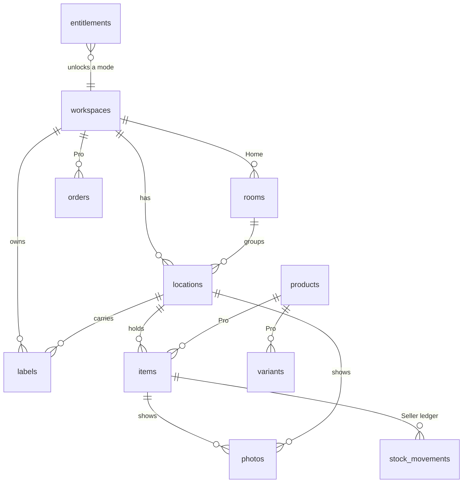

# BoxTap — On-Device Database Schema (v1.0, local-first)

SQLite 3.34+ inside SQLCipher, one encrypted database file per app install. No server database exists. The earlier Postgres schema is in `archive/cloud-v0.2/DATABASE_SCHEMA.md`.

## 1. Entity relationships



App-level tables (`entitlements`, `licence_keys`, `app_config`, `time_guard`, `backup_state`, `meta`) are not tied to a workspace.

## 2. Conventions

- `PRAGMA foreign_keys = ON; PRAGMA journal_mode = WAL;` on every open.
- IDs: UUID v7 text, generated in the app (sync-ready, ADR-005).
- Times: ISO-8601 UTC text. Money: integer **minor units** (cents / paisa) to avoid rounding errors, with the workspace's currency.
- Every business table: `created_at`, `updated_at`, `deleted_at` (30-day bin).
- Schema version in `PRAGMA user_version`; migrations run in a transaction at app start, after an automatic local safety copy of the database file. If a migration fails, the app restores the copy and shows a recovery screen that can still write a full backup file (a raw copy, no schema knowledge needed) and report the error; the next app update retries the migration (audit L9).

## 3. DDL

```sql
CREATE TABLE meta (key TEXT PRIMARY KEY, value TEXT NOT NULL);       -- install_id, device_hint, first_launch_at

CREATE TABLE workspaces (
  id          TEXT PRIMARY KEY,
  type        TEXT NOT NULL CHECK (type IN ('home','seller')),
  name        TEXT NOT NULL CHECK (length(name) BETWEEN 1 AND 80),
  country     TEXT NOT NULL CHECK (country IN ('AU','BD')),
  currency    TEXT NOT NULL CHECK (currency IN ('AUD','BDT')),
  language    TEXT NOT NULL DEFAULT 'en' CHECK (language IN ('en','bn')),
  jewellery_fields INTEGER NOT NULL DEFAULT 0,                      -- ADR-012 switch
  next_box_number INTEGER NOT NULL DEFAULT 1,
  created_at  TEXT NOT NULL, updated_at TEXT NOT NULL, deleted_at TEXT
);

CREATE TABLE rooms (
  id TEXT PRIMARY KEY,
  workspace_id TEXT NOT NULL REFERENCES workspaces(id) ON DELETE CASCADE,
  name TEXT NOT NULL CHECK (length(name) BETWEEN 1 AND 60),
  colour TEXT NOT NULL DEFAULT 'blue',
  sort_order INTEGER NOT NULL DEFAULT 0,
  created_at TEXT NOT NULL, updated_at TEXT NOT NULL, deleted_at TEXT
);

CREATE TABLE locations (
  id TEXT PRIMARY KEY,
  workspace_id TEXT NOT NULL REFERENCES workspaces(id) ON DELETE CASCADE,
  number INTEGER NOT NULL CHECK (number > 0),
  name TEXT CHECK (length(name) <= 80),
  kind TEXT NOT NULL DEFAULT 'box' CHECK (kind IN ('box','tub','drawer','shelf','bag','other')),
  room_id TEXT REFERENCES rooms(id),
  spot TEXT CHECK (length(spot) <= 80),                              -- gap G5
  colour TEXT,
  is_fragile INTEGER NOT NULL DEFAULT 0,
  open_first INTEGER NOT NULL DEFAULT 0,
  move_status TEXT CHECK (move_status IN ('packed','moved','unpacked')),
  notes TEXT CHECK (length(notes) <= 2000),
  created_at TEXT NOT NULL, updated_at TEXT NOT NULL, deleted_at TEXT,
  UNIQUE (workspace_id, number)
);

CREATE TABLE labels (                                                -- gap G6: reprint, spare labels
  code TEXT PRIMARY KEY CHECK (length(code) = 10),                   -- Crockford base32
  workspace_id TEXT NOT NULL REFERENCES workspaces(id) ON DELETE CASCADE,
  location_id TEXT REFERENCES locations(id),                         -- NULL = printed spare
  created_at TEXT NOT NULL, retired_at TEXT
);
CREATE INDEX labels_location ON labels(location_id);

CREATE TABLE items (
  id TEXT PRIMARY KEY,
  workspace_id TEXT NOT NULL REFERENCES workspaces(id) ON DELETE CASCADE,
  location_id TEXT NOT NULL REFERENCES locations(id),
  product_id TEXT, variant_id TEXT,                                  -- Phase 3
  name TEXT NOT NULL CHECK (length(name) BETWEEN 1 AND 120),
  alt_name TEXT CHECK (length(alt_name) <= 120),                     -- gap G8
  notes TEXT CHECK (length(notes) <= 2000),
  value_estimate_minor INTEGER CHECK (value_estimate_minor >= 0),    -- Home insurance PDF
  on_hand INTEGER NOT NULL DEFAULT 0,                                -- written only by triggers
  reserved INTEGER NOT NULL DEFAULT 0,                               -- written only by triggers
  low_stock_level INTEGER CHECK (low_stock_level >= 0),
  sale_price_minor INTEGER CHECK (sale_price_minor >= 0),
  cost_price_minor INTEGER CHECK (cost_price_minor >= 0),            -- Pro; single owner device for now
  pricing_mode TEXT NOT NULL DEFAULT 'per_piece' CHECK (pricing_mode IN ('per_piece','by_weight')),
  weight_mg INTEGER CHECK (weight_mg > 0),                           -- ADR-012, milligrams
  purity TEXT CHECK (length(purity) <= 20),
  making_charge_minor INTEGER CHECK (making_charge_minor >= 0),
  created_at TEXT NOT NULL, updated_at TEXT NOT NULL, deleted_at TEXT
);
CREATE INDEX items_location ON items(location_id) WHERE deleted_at IS NULL;

CREATE TABLE photos (
  id TEXT PRIMARY KEY,
  workspace_id TEXT NOT NULL REFERENCES workspaces(id) ON DELETE CASCADE,
  location_id TEXT REFERENCES locations(id),
  item_id TEXT REFERENCES items(id),
  file_name TEXT NOT NULL,                                           -- photos/{id}.webp in app folder
  thumb_name TEXT NOT NULL,
  bytes INTEGER NOT NULL CHECK (bytes BETWEEN 1 AND 600000),
  created_at TEXT NOT NULL, deleted_at TEXT,
  CHECK ((location_id IS NULL) <> (item_id IS NULL))
);

CREATE TABLE stock_movements (                                       -- insert-only ledger (ADR-004)
  id TEXT PRIMARY KEY,
  workspace_id TEXT NOT NULL REFERENCES workspaces(id) ON DELETE CASCADE,
  item_id TEXT NOT NULL REFERENCES items(id),
  on_hand_delta INTEGER NOT NULL,
  reserved_delta INTEGER NOT NULL DEFAULT 0,
  reason TEXT NOT NULL CHECK (reason IN ('sold','restock','count','damaged','returned','moved_in','moved_out',
                                         'booked','unbooked','shipped','undo','opening')),
  reverses_id TEXT UNIQUE REFERENCES stock_movements(id),
  happened_at TEXT NOT NULL,
  note TEXT CHECK (length(note) <= 200),
  CHECK (on_hand_delta <> 0 OR reserved_delta <> 0),
  CHECK ((reason = 'undo') = (reverses_id IS NOT NULL)),
  CHECK (CASE reason
    WHEN 'sold' THEN on_hand_delta < 0 AND reserved_delta = 0
    WHEN 'damaged' THEN on_hand_delta < 0 AND reserved_delta = 0
    WHEN 'moved_out' THEN on_hand_delta < 0 AND reserved_delta = 0
    WHEN 'restock' THEN on_hand_delta > 0 AND reserved_delta = 0
    WHEN 'returned' THEN on_hand_delta > 0 AND reserved_delta = 0
    WHEN 'moved_in' THEN on_hand_delta > 0 AND reserved_delta = 0
    WHEN 'opening' THEN on_hand_delta > 0 AND reserved_delta = 0
    WHEN 'booked' THEN on_hand_delta = 0 AND reserved_delta > 0
    WHEN 'unbooked' THEN on_hand_delta = 0 AND reserved_delta < 0
    WHEN 'shipped' THEN on_hand_delta < 0 AND reserved_delta = on_hand_delta
    ELSE 1 END)
);
CREATE INDEX sm_item_time ON stock_movements(item_id, happened_at DESC);

CREATE TRIGGER sm_apply AFTER INSERT ON stock_movements BEGIN
  UPDATE items SET on_hand = on_hand + NEW.on_hand_delta,
                   reserved = reserved + NEW.reserved_delta,
                   updated_at = NEW.happened_at
   WHERE id = NEW.item_id;
END;
CREATE TRIGGER sm_no_update BEFORE UPDATE ON stock_movements BEGIN
  SELECT RAISE(ABORT, 'ledger_is_append_only');
END;
CREATE TRIGGER sm_no_delete BEFORE DELETE ON stock_movements
  WHEN (SELECT deleted_at FROM workspaces WHERE id = OLD.workspace_id) IS NULL BEGIN
  SELECT RAISE(ABORT, 'ledger_is_append_only');
END;

-- Search (ADR-011)
CREATE VIRTUAL TABLE item_search USING fts5(name, alt_name, notes, location_label,
  item_id UNINDEXED, workspace_id UNINDEXED, tokenize = 'trigram');
-- kept in step by AFTER INSERT/UPDATE/DELETE triggers on items and locations

-- App-level licensing tables (see API_CONTRACTS.md §2-4)
CREATE TABLE entitlements (
  id TEXT PRIMARY KEY,                       -- store order id or licence key id
  source TEXT NOT NULL CHECK (source IN ('google_play','app_store','licence_key')),
  plan TEXT NOT NULL CHECK (plan IN ('move_pass','seller_pro')),
  starts_at TEXT NOT NULL, ends_at TEXT NOT NULL,
  verified_at TEXT NOT NULL,
  raw_signed TEXT NOT NULL                   -- signed purchase / key, re-verified at every app start
);
CREATE TABLE app_config (id INTEGER PRIMARY KEY CHECK (id = 1), seq INTEGER NOT NULL,
  issued_at TEXT NOT NULL, body TEXT NOT NULL, signature TEXT NOT NULL);
CREATE TABLE time_guard (id INTEGER PRIMARY KEY CHECK (id = 1), max_seen_at TEXT NOT NULL,
  trusted_at TEXT, trusted_source TEXT);     -- clock-rollback protection
CREATE TABLE backup_state (id INTEGER PRIMARY KEY CHECK (id = 1), last_backup_at TEXT,
  folder_uri TEXT, recovery_confirmed INTEGER NOT NULL DEFAULT 0);
```

**Note on `on_hand` / `reserved`:** SQLite has no column permissions. The rule "only the ledger changes stock" is enforced in code: only the `stock` repository writes movements, no repository updates these columns, and a lint rule blocks the strings `SET on_hand` / `SET reserved` outside the trigger. The daily self-check (§5) is the safety net (audit L5). A workspace is erased by setting its `deleted_at` first, which allows the cascade to remove its ledger rows.

## 4. Business rules in code (repositories)

| Rule | Where | Notes |
| --- | --- | --- |
| Box numbers | `locations.create` reads and increments `workspaces.next_box_number` in the same transaction | One device, so no clashes |
| Label codes | `labels.createBatch(n)` uses `crypto.getRandomValues`, retries on the rare clash | Printed spares have `location_id = NULL` |
| Free limits | `entitlements.can('add_box' / 'add_item' / 'add_photo')` before insert | Limits come from signed config (defaults built in) |
| Undo | `stock.undo(id)`: same item, only within 24 h, exact negative deltas | UI shows Undo for 10 s |
| Move stock | `stock.move(fromItem, toLocation, qty)`: two movements + optional new item row, one transaction | ADR-006 |
| Count mode | `stock.count(location, counts)`: one `count` movement per changed item | S-07 |
| Negative stock | Allowed only through `count` corrections; `sold` that would go below 0 asks "Only 0 left, sell anyway?" | One device, so negatives come only from user choice |

## 5. Self-checks and maintenance (at app start, at most once a day)

1. `PRAGMA integrity_check` (quick variant).
2. Ledger check: compare `items.on_hand/reserved` with `SUM` over `stock_movements`; if different, fix the cache from the ledger and log it locally.
3. Purge rows in the bin for more than 30 days (Seller items with movements stay archived).
4. Remove orphan photo files.
5. Backup due? Run it (ADR-016).
6. Config due? Fetch it (API_CONTRACTS §3).

## 6. Data lifecycle

| Data | Kept | Removed |
| --- | --- | --- |
| Everything | On the phone while the app is installed | Uninstall, or Settings → Erase all data (asks twice) |
| Bin | 30 days | Daily purge |
| Backups | Last 4 files in the user's folder | Older files deleted by the app; the user controls the folder |
| Licence data | Re-derived from the store on restore | — |
