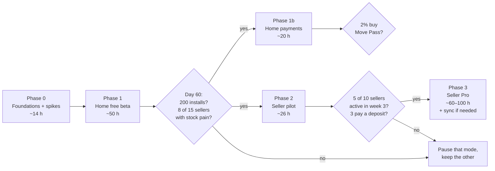

# BoxTap — Implementation Roadmap (v1.0, local-first)

Phases and checkpoints follow the requirements doc. Hours are estimates 📐. **Nothing here authorises code changes; implementation starts only after the owner approves and names a GitHub repository.**

Note: "sign-ups" in the checkpoints become **installs** (from the store consoles), since there are no accounts.

## Phase 0 — Foundations and spikes (~14 h)

| Work | Acceptance |
| --- | --- |
| Repo: Vite + React + TS + Capacitor; Android and iOS projects; Tailwind; ESLint; Vitest; Playwright | App runs on an Android emulator and an iPhone simulator |
| SQLCipher database, key in Keystore/Keychain, migration runner | Critical test 1 passes |
| Spike: FTS5 trigram inside SQLCipher (R9) | Works, or `LIKE` fallback chosen |
| Spike: billing plugin supports Play prepaid plans and StoreKit 2 (R8) | Sandbox purchase verified on both, or custom plugin decided |
| Static site on Cloudflare Pages with app-link files; owner key tool (`tools/keys.ts`, `tools/licence.ts`, `tools/sign-config.ts`) | Test link opens the app on both platforms; signed config verifies in the app |
| CI: build, tests, secret scan; Android build on GitHub Actions; iOS build via Mac or cloud build | Green pipeline |
| Store accounts: Google Play (US$25), Apple Developer (US$99) | Internal testing track and TestFlight ready |

## Phase 1 — Home free beta (~50 h, weeks 2–7)

C-03–C-10 (local), C-12 basics, C-13, H-01–H-03, gaps G1 (contents photo), G5 (`spot`), G6 (labels), arrival check, backups (ADR-016).

| Step | Depends on | Acceptance |
| --- | --- | --- |
| 1. First launch: choose Home, language, recovery code | Phase 0 | Onboarding < 1 min |
| 2. Rooms, boxes, items, photos | 1 | CRUD + 30-day bin |
| 3. Label batches and PDF printing | 2 | Print test on 3 printers |
| 4. Scanner + app links | 3 | Critical tests 5–7 |
| 5. Search (FTS5) | 2 | 400 items < 1 s |
| 6. Free limits via `can()` + built-in defaults | 2 | Critical test 8 |
| 7. Backup and restore | 2 | Critical tests 2–4, 9 |
| 8. Release to Play closed testing + TestFlight, then production | all | Store reviews passed |

## Phase 1b — Home payments (~20 h, weeks 8–10)

H-04 (store billing), H-06, H-07 insurance PDF, H-08 as local notifications, share-out PDFs (family, removalist), move status, Restore purchases, signed config live, `trustedNow()`.
Acceptance: critical tests 10–15.

## Phase 2 — Seller pilot (~26 h, weeks 9–12)

Seller workspace, S-01–S-10, booked tap (ADR-013), jewellery fields (ADR-012), `alt_name` search, catalogue image (ADR-015), Bangla screens, pilot licence keys, distribution through the Play closed testing track. Single device per seller.
Acceptance: critical tests 16–21; catalogue image shares to WhatsApp from a low-cost Android phone.

## Phase 3 — Seller Pro (~60–100 h, from month 4, only if Phase 2 passes)

S-20 variants, S-21 low-stock notifications, S-23 cost/profit, S-24 orders, S-26 full Bangla, Seller Pro subscriptions in both stores. **Staff (S-22) and two phones (S-11) only with a sync add-on (+25–40 h)**, decided from pilot evidence.

## Definition of done (every step)

Reviewed, tests written and passing in CI, migrations tested from every earlier schema version, docs updated in the same PR, checked on one real Android and one real iPhone.
