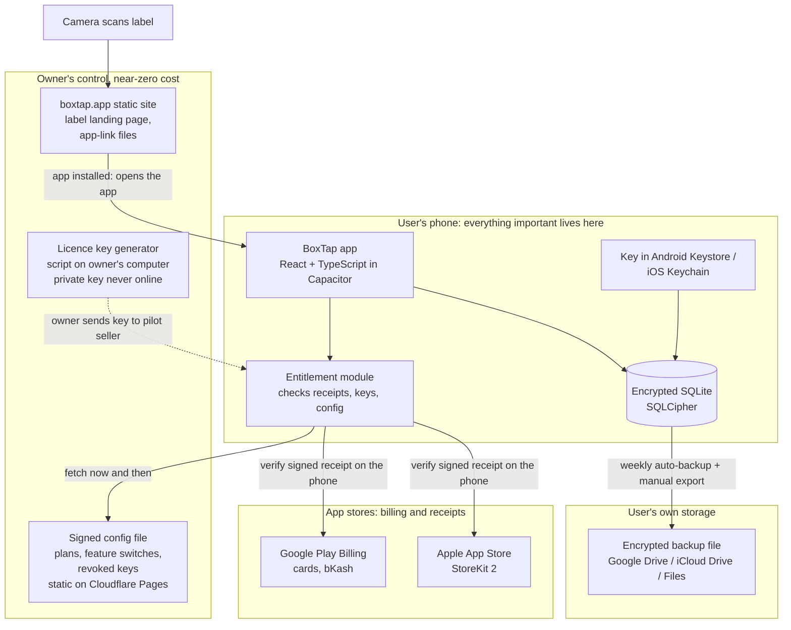
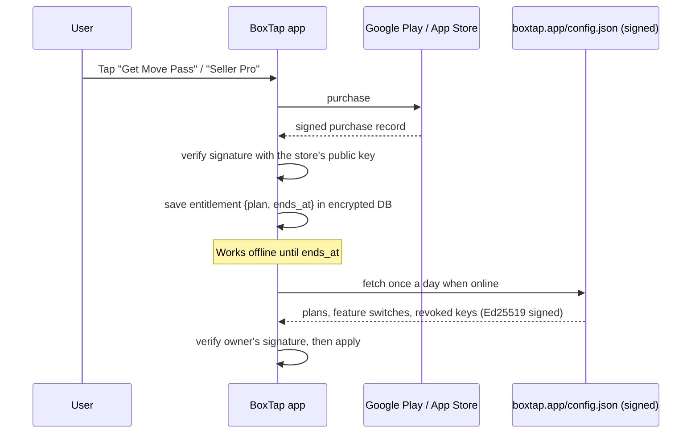

# BoxTap — Local-First Architecture Proposal

Version 0.1 · 2026-11-23 · **Status: Local-first with one device per user chosen by the owner on 2026-11-23.** The full design is in ARCHITECTURE.md v1.0 and the files it links.

Labels: **Fact**, **Assumption**, **Recommendation**, **Open decision**.

## 1. The owner's new goals (confirmed requirements)

1. Each user's data lives on their own device, not in a central database.
2. No paid backend such as Supabase or Firebase.
3. The owner controls licences, premium features and subscriptions.
4. Free and paid plans, recurring subscriptions, premium features stop when a subscription ends.
5. The lowest practical running cost.
6. Core features work offline; licence checks may need the internet now and then.
7. Local data is protected, and paid features are hard to unlock without paying.

## 2. Recommendation in one paragraph

Build BoxTap as a **native app for Android and iPhone using Capacitor**, which reuses the React + TypeScript screens already planned. All data goes into an **encrypted SQLite database on the phone**. **Payments go through Google Play and the App Store**, whose signed receipts the app checks on the phone itself, so no payment server is needed. The owner keeps control through **signed licence keys** (for pilots, promos and gifts) and a **signed remote config file** (plans, feature switches, revoked keys), both hosted as static files for free. **Backups go to the user's own Google Drive or iCloud** as an encrypted file. Fixed running cost: about **US$10 a month**, mostly the Apple developer fee.

## 3. Architecture overview

## 4. What changes from the cloud plan, honestly

The local-first goal is achievable, but it removes some things the earlier requirements relied on. Each row says what replaces it.

| Requirement | Cloud plan (v0.2) | Local-first | Effect |
| --- | --- | --- | --- |
| C-01 sign-up | Email account | **No account needed.** Purchases are tied to the Google/Apple account | Faster start. Better |
| C-04/C-05 private QR scan | Server shows box number to strangers | QR opens `boxtap.app/b/CODE`; the app opens and looks the code up **on the phone**. A stranger without the app sees a static "This is a BoxTap label" page | More private. Better |
| C-07 search, C-09 offline | Cache + server | Everything is local and offline | Better |
| C-11 billing | Stripe, SSLCommerz, webhooks | Google Play and App Store billing (§6) | Simpler; stores take 15% |
| C-13 export / delete | Server job | Export file; uninstall deletes everything | Simpler |
| C-14 admin KPIs | Own events table | Play Console and App Store Connect give installs, purchases, retention for free. No per-user activity data | Less detail. **Trade-off** |
| H-05 share link for family/removalist (live, revocable) | Server link | Share a **PDF or image** of chosen boxes through WhatsApp/email. A sent file cannot be taken back | **Lost: live updates and revoke** |
| H-08 reminder emails | Server email | Phone notifications (local, no server) | Same purpose |
| Mia and her partner packing on two phones | Shared workspace | **Not possible without sync** (§7) | **Lost in MVP** |
| S-11 two seller phones, S-22 staff accounts | Shared database | **Not possible without sync** (§7) | **Lost in MVP** |
| N-01 desktop browser | PWA | Phones only in MVP | **Lost in MVP** |
| N-10 backups | Daily server backups | User-owned encrypted backups, automatic weekly prompt | **Risk: a lost phone without a backup loses data** |
| Stock ledger, booked tap, count mode, catalogue image, jewellery fields | Postgres | Same design in SQLite | Kept unchanged |

## 5. On-device data and security

- **Database:** SQLite through `@capacitor-community/sqlite`, encrypted with SQLCipher (AES-256). The same tables as `DATABASE_SCHEMA.md` minus the server-only parts (RLS, `members`, `payments`, `provider_events`). The insert-only stock ledger and its trigger move unchanged into SQLite.
- **Encryption key:** a random 256-bit key created at first launch and kept in the Android Keystore / iOS Keychain. Optional app lock with fingerprint/face.
- **Photos:** compressed WebP files in the app's private folder; the database holds their paths.
- **Backups (the most important new feature):**
  - At setup the app shows a **12-word recovery code** (Recommendation). Backups are encrypted with a key derived from it, so a backup can be restored on a new phone even though the Keystore key never leaves the old phone.
  - Weekly automatic backup to a place the user picks once (Google Drive or iCloud Drive via the system file picker), plus "Back up now".
  - A banner appears if the last backup is older than 14 days.
  - Restore: install the app, choose the backup file, enter the recovery code.
- **QR codes:** made on the phone (10 random characters). Two users can never clash in practice, and the lookup is local anyway.
- **Universal links / App Links:** `boxtap.app` serves `apple-app-site-association` and `assetlinks.json` from free static hosting, so the iPhone and Android cameras open the app directly when it is installed.

## 6. Licensing and subscriptions

### 6.1 Options compared

| Option | How it works | Owner control | Running cost | Offline | Third parties |
| --- | --- | --- | --- | --- | --- |
| **A. Store billing + on-phone receipt check + signed keys + signed config** (Recommended) | App reads the store's signed purchase record and checks it on the phone. Owner issues signed licence keys and publishes a signed config file | Plans, prices, feature switches, free pilot keys, key revocation | ≈ US$0 server (static files) | Works offline until the subscription end date | Google, Apple only |
| B. Option A + RevenueCat | RevenueCat tracks purchases from both stores and gives a dashboard | Strong dashboard, refunds, grace periods, promo offers | Free under about US$2,500 monthly revenue, then a percentage (Assumption, re-check) | Same | Adds RevenueCat |
| C. Own licence server | A small Cloudflare Worker + D1 database checks receipts with Google/Apple servers, issues signed tokens, takes direct payments (Stripe, SSLCommerz) | Full control, cross-platform licences, direct web payments | Free tier first, then about US$5/month (Assumption) | Signed tokens work offline for a grace period | Cloudflare |

**Recommendation: start with A.** It meets every goal with no server at all. Move to C only if you later need direct payments outside the stores or one licence across Android and iPhone.

### 6.2 How Option A works

- **Move Pass (Home):** App Store "non-renewing subscription" (12 months), Google Play one-time product with the 12-month end date kept by the app. Renewal = buy again; the new 12 months start when the old ones end (ADR-014 still holds).
- **Seller Pro (Bangladesh, Australia):** auto-renewing store subscription. Google Play supports bKash in Bangladesh (Fact, per the requirements doc's source; re-check).
- **Pilot sellers and promotions:** the owner runs a small script on their own computer that signs a licence key such as `{plan: seller_pro, device_hint, ends_at: 2027-03-01}` with an Ed25519 private key. The app holds only the public key, so nobody can make a key without the owner's private key.
- **Expiry:** when `ends_at` passes, premium features stop (no new boxes beyond the free limit, no Pro screens), but **all data stays readable and exportable** (H-06). A 3-day grace period covers phones that were offline when a renewal happened.
- **Remote control:** the signed config can switch features on or off, change free limits for new installs, or revoke a leaked licence key. Phones that never go online keep their last config, which is acceptable.

### 6.3 Payment changes to accept

- Inside store apps, paid digital features generally must use the store's own billing, so **Stripe and SSLCommerz direct payments drop out of the MVP** (Assumption based on current Apple and Google rules, which have been changing; re-check before launch).
- Store commission: 15% for small developers on both stores (Fact for the small-business programmes; re-check). On A$12.95 that is about A$1.94, compared with about A$0.51 on Stripe.

### 6.4 How strong the licence protection is

On-phone checks stop normal users and casual sharing. **A skilled person with a rooted or jailbroken phone can patch any app that checks licences only on the phone** (Fact). Adding Google Play Integrity / Apple App Attest makes this much harder but needs a server to check them (Option C). For apps priced at A$12.95 or ৳199, Option A's protection is the practical choice (Recommendation).

## 7. Multi-device and staff: the one real gap

Sharing between phones needs *something* in the middle. Options, cheapest first:

| Option | How | Cost to owner | Effort | Fit |
| --- | --- | --- | --- | --- |
| 1. Single device only (MVP) | One phone per workspace; share PDFs/images | US$0 | None | Fine for most movers and solo sellers (Assumption) |
| 2. Sync through the user's own Google Drive / iCloud | Each phone writes encrypted change files to a shared folder; others read and merge them (the stock ledger merges safely because movements only add up) | US$0 | ~25–35 h 📐 | Works for a family or a seller + 1 helper; slow (minutes) |
| 3. Paid end-to-end encrypted sync relay | A tiny Cloudflare Worker passes encrypted change batches between a workspace's phones. The server cannot read them | Free tier first, then small; paid by Pro users | ~30–40 h 📐 | Near real-time; best for staff accounts (S-22) |

**Recommendation:** Option 1 for Phases 1 and 2. Decide between 2 and 3 after the Seller pilot shows whether sellers really use two phones. The ledger design (ADR-004/005) already makes either sync option safe from double counting.

## 8. Costs

| Item | Cost | Needed for |
| --- | --- | --- |
| Google Play developer account | US$25 once (Fact) | Android |
| Apple Developer Program | US$99 a year (Fact) | iPhone (Australia is iPhone-heavy) |
| Domain `boxtap.app` | about US$15 a year (Assumption) | Label links, config file |
| Cloudflare Pages (static site + config) | US$0 | Label landing page, app-link files |
| iOS builds | A Mac, or a cloud build service's free tier (e.g. Codemagic, about 500 free minutes a month, Assumption) | iPhone builds |
| Store commission | 15% of sales | Every purchase |
| **Fixed total** | **about US$115–130 a year (≈ US$10/month)** | — |

Compared with the cloud plan's about US$30–40 a month, plus it no longer grows with the number of users.

## 9. Effect on the build plan

| Phase | Change | Estimate 📐 |
| --- | --- | --- |
| 0 Foundations | Capacitor project, Android + iOS builds, encrypted SQLite, CI | ~14 h (was 10) |
| 1 Home free beta | No auth, no RLS, no server functions; adds universal links, backups, recovery code | ~50 h (was 55) |
| 1b Home payments | Store billing, signed config, local reminders, PDF/image share | ~20 h (was 24) |
| 2 Seller pilot | Same features; pilot licence keys instead of free pilot accounts; single device | ~26 h (was 28) |
| 3 Seller Pro | Store subscriptions; staff needs sync option 2 or 3 (+25–40 h) | 85–140 h |

Store review adds 1–3 days per release (Assumption), so releases are less instant than a web app.

## 10. Open decisions for the owner

1. Is one device per workspace acceptable for the first release? (Family packing and seller staff come later with sync.)
2. Launch on iPhone from day 1 (US$99/year and a Mac or cloud builds), or Android first?
3. Accept store billing with 15% commission and drop Stripe/SSLCommerz for now?
4. Accept that users own their backups (the app automates and reminds), knowing a lost phone without a backup loses data?
5. Drop the desktop/browser version for now?
