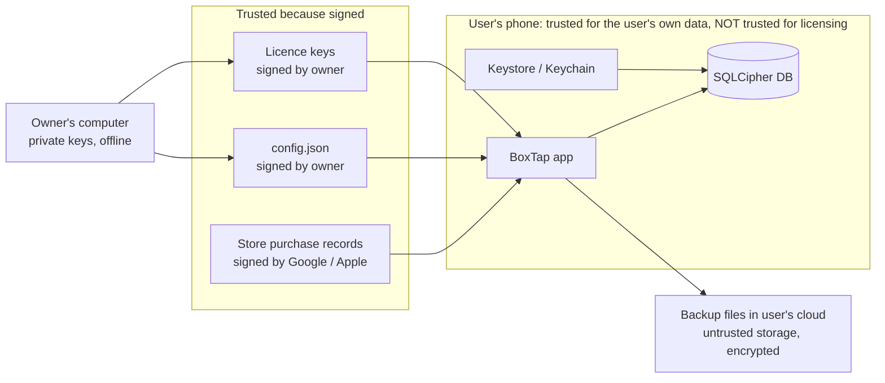

# BoxTap — Security Model (v1.0, local-first)

## 1. Trust boundaries

Two separate questions:
1. **Protecting the user's data** from other people (thieves, other apps, cloud providers). The phone and its OS are on the user's side.
2. **Protecting the owner's paid features** from users who don't pay. Here the phone is in the user's hands and cannot be fully trusted; signatures make forging hard, but a patched app can skip checks.

## 2. Protecting user data

| Threat | Control | Residual |
| --- | --- | --- |
| Phone stolen, unlocked | Optional app lock (PIN / fingerprint / face) after 5 minutes in background | Medium if the user doesn't turn it on |
| Phone stolen, locked | OS encryption + SQLCipher; key in Keystore/Keychain bound to the device | Low |
| Another app reads BoxTap files | App sandbox; files in private app storage | Low |
| Backup file leaked from Google Drive/iCloud | AES-256-GCM; key wrapped by Argon2id of a 12-word code (~128 bits) | Low |
| Lost phone, no backup | Weekly auto-backup, 14-day banner, recovery code at setup | **Medium: user responsibility** |
| Malicious QR code (someone else's link) | App accepts only `boxtap.app/b/<10 valid chars>`; anything else is ignored | Low |
| Corrupted database (crash, full storage) | WAL mode, transactions, integrity check, safety copy before migrations, backups | Low |
| Shared family phone (Bangladesh, gap G9) | App lock option; cost prices hidden behind the lock in Pro | Medium |
| XSS-like injection via item names in PDFs or images | Text drawn as text (pdf-lib, Canvas), never as HTML | Low |

**Privacy:** BoxTap collects no personal data on any server. No account, no email, no analytics SDK. The privacy policy (English and Bangla) says this plainly. Store purchase data is handled by Google/Apple under their policies. Bangladesh consent screen still shown at first launch in Bangla (N-09), describing that data stays on the phone.

## 3. Protecting paid features (licensing)

| Threat | Control | Residual |
| --- | --- | --- |
| Fake purchase record | Signature verified on the phone (Google RSA key, Apple JWS chain) | Low |
| Fake licence key | Ed25519 signature; private key never online | Low |
| Sharing one licence key with friends | Pilot keys bound to install ID; promo keys short; leaked keys revoked via config | Low–Medium |
| Old, more generous config replayed | `seq` must increase | Low |
| Phone clock set backwards to extend a plan | `trustedNow()` with high-water mark (API_CONTRACTS §5) | Low |
| Stay offline forever after a subscription lapses | Auto-renewing plan ends at the last known expiry + 3 days grace; renewals need one online check | Low |
| Refund then keep using | Recomputed from the store at each online start | Low |
| Database edited on a rooted phone to add an entitlement | Entitlements re-verified from `raw_signed` at every start; an unsigned row is ignored | Low |
| App binary patched to skip `can()` (rooted/jailbroken phone) | Code minification; checks spread over a few call sites; Play Integrity / App Attest **not used** (they need a server to verify) | **Medium, accepted**: low price makes cracking unattractive; revenue loss expected to be small (Assumption) |

## 4. Key management (owner)

| Key | Purpose | Storage | Rotation |
| --- | --- | --- | --- |
| Config signing key (`cfg-YYYY`) | Signs `config.json` | Owner's computer, encrypted file; offline backup in a password manager + printed copy | Yearly; app ships with current and next public key |
| Licence signing key (`lic-YYYY`) | Signs licence keys | Same, separate file | Yearly, same method |
| Android upload / app-signing key | Store releases | Play App Signing (Google holds app-signing key); upload key in owner's password manager | If lost, reset via Play Console |
| Apple certificates | iOS releases | Apple developer account, 2FA on | Apple-managed |
| Play billing public key | Purchase verification | Built into the app (public) | — |

**If the config private key leaks:** ship an app update with a new public key and a `kid` deny-list; publish a config signed with the new key. Users who don't update keep the last valid config (acceptable).

## 5. Store and policy checks (pre-launch)

- [ ] "Restore purchases" button on the upgrade screen (App Store requirement)
- [ ] Subscription terms and price shown before purchase; link to manage subscription
- [ ] Privacy policy URL in both store listings; App Store privacy label "Data not collected" (true for this design)
- [ ] Data safety form on Google Play: no data collected or shared
- [ ] Camera permission text in English and Bangla explains it is for scanning labels and taking box photos
- [ ] No hidden paywall around export or reading data (H-06)

## 6. Development security checklist

- [ ] Private keys never in the repository (CI secret scan blocks PEM/`ed25519` private key patterns)
- [ ] Release builds minified; no debug logs of item names
- [ ] SQLCipher key never written to logs or crash reports
- [ ] Backup crypto tested with known-answer test vectors
- [ ] Dependency audit (`npm audit`, Dependabot) on every PR
