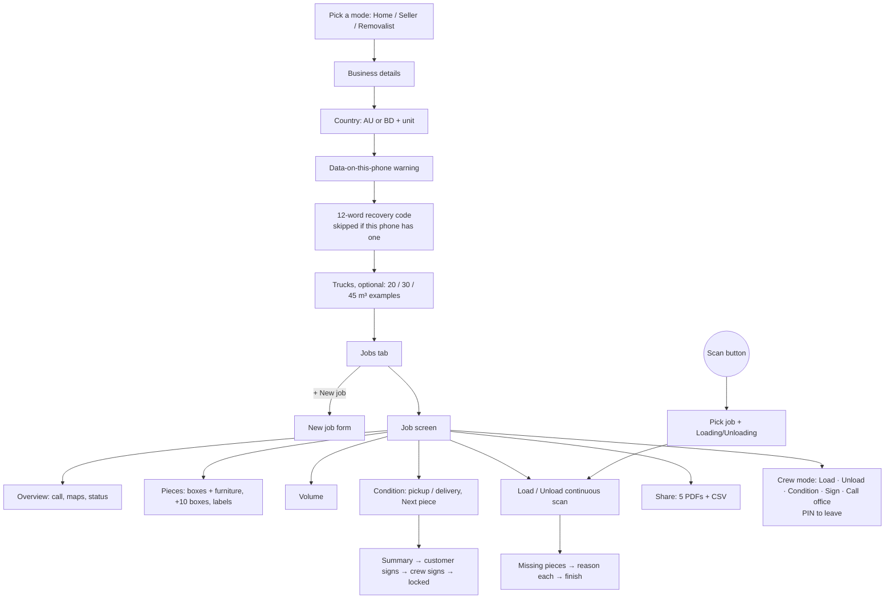

# Removalist mode — Phase 0 plan

Status: **draft for the owner's review. No code has been written.** Phase 1 starts only after the owner says "go".
Written 26 Nov 2026 from `REMOVALIST_MODE_BUILD.md` (the instruction) and a read of the code on `main` in `C:\tonmoy\BOXTAP`.

Labels used below: **Fact** (checked in the code), **Decision** (my proposal, fits the instruction), **Conflict** (the instruction and the code disagree; my proposed fix), **Question** (needs the owner).

---

## 1. What I read

`BUILD_NOTES.md` (in full), `USER_GUIDE.md`, `BOXTAP_OVERVIEW.md` (project files, searched for Home/Removalist overlap), `boxtap-architecture/DESIGN_SYSTEM.md` (colour tokens), `src/core/db/{schema,migrate,worker,ledgerCheck}.ts`, `src/core/backup/{snapshot,keystore,backupFile}.ts`, `src/core/licensing/{can,config,plans}.ts`, `src/core/repo/{places,photos,bin,export,labels,core}.ts`, `src/core/service/service.ts`, `src/core/labels/{pdf,layout,textImage}.ts`, `src/core/pdf/lists.ts`, `src/core/photos/{encode,save,store}.ts`, `src/core/scan/scanner.ts`, `src/app/{App,router,context,ui}.tsx`, `src/app/screens/{Start,Backup,BoxPage,ScanLabels,Misc,Home,Rooms}.tsx`, `src/i18n/i18n.ts`, `src/index.css`, `e2e/app.spec.ts` (test names).

Baseline to keep green: **256 unit tests, 85 browser tests** (current, from the last thread; `BUILD_NOTES.md` still says 250). I will re-run both before Phase 1 and record the real numbers.

## 2. Facts from the code that shape the plan

1. **Fact:** `workspaces.type` has `CHECK (type IN ('home','seller'))`. SQLite can't change a CHECK with `ALTER TABLE`, so adding `'removalist'` means rebuilding the `workspaces` table.
2. **Fact:** `locations.kind` already exists with values `box, tub, drawer, shelf, bag, other`, and `locations` has `UNIQUE (workspace_id, number)`.
3. **Fact:** `photos` has `CHECK ((location_id IS NULL) <> (item_id IS NULL))` and `bytes ≤ 600 000`. A signature or a logo has no box or item, so it can't be a `photos` row.
4. **Fact:** the recovery code and backup key are **per phone**, not per workspace (`backup_state` is one row; the key is one IndexedDB entry). Settings can already "add a Seller list, switch between lists".
5. **Fact:** `can()` picks the plan with `workspaceType === 'home' ? 'move_pass' : 'seller_pro'`, so a new type would silently get Seller rules. `entitlements.plan` has `CHECK (plan IN ('move_pass','seller_pro'))`.
6. **Fact:** backups (`.btbak` and Drive) copy the whole database plus every photo file. New tables, and blobs inside them, are included automatically.
7. **Fact:** the restore check builds a reference database from `MIGRATIONS` and compares every trigger and index by exact SQL, and tables by columns. New triggers are protected as soon as they are in the v6 migration.
8. **Fact:** photos are stored as **WebP** where the browser can make it. `pdf-lib` embeds only JPEG and PNG, and `lists.ts` silently skips a photo it can't embed.
9. **Fact:** photos are added through a file input (no `capture` attribute), so the app can't tell a camera shot from a library pick today. The camera code exists only inside the scanner.
10. **Fact:** the scanner already ignores a repeat of the same QR text and accepts only `https://boxtap.app/b/<code>`. The browser tests have no camera; "scan" tests open `/b/<code>` links.
11. **Fact:** Home mode already has a **"Removalist list"** PDF (a Home user gives it to their mover). Same word, different thing.
12. **Fact:** the project's Bangla-review convention is a key list in `BUILD_NOTES.md` ("Bangla strings for native review").

## 3. Conflicts with the instruction, and my proposed fix

| # | Instruction says | Code reality | Proposed fix |
|---|---|---|---|
| C1 | Add `kind` (`box`/`piece`) to `locations` | `kind` already exists with other values | Add a separate column `is_piece` (0/1). Home/Seller rows get 0. |
| C2 | Numbering restarts per job ("Box 1" in every job) | `UNIQUE (workspace_id, number)` | Keep `number` as the internal, workspace-wide number. Add `job_seq` with a unique index on `(job_id, is_piece, job_seq)`. Removalist screens, labels and PDFs show `job_seq`. |
| C3 | Signature stored "as a photo" | photos must belong to a box or item | Store the signature PNG as a small BLOB (≤ 100 KB) in `signoffs`, and the logo as a BLOB (≤ 200 KB) in `business_profile`. Both travel in backups. |
| C4 | "Each workspace has its own recovery code" | One code per phone | Same conclusion (one workspace = the business), different reason. If Removalist is added from Settings on a phone that already has a code, the code step is skipped. |
| C5 | v5 → v6 "the same way earlier migrations do" | Earlier migrations only add columns/tables; v6 must rebuild `workspaces` (FK parent of everything) and `entitlements` | `migrate()` gets a "rebuild" migration path: foreign keys off **outside** the transaction (SQLite ignores the switch inside one), rebuild, `foreign_key_check`, foreign keys back on. A plain `DROP TABLE workspaces` with foreign keys on would cascade-delete all data, so a test proves no row is lost. |
| C6 | — | `BUILD_NOTES` deferred item: "migrate() must make a safety copy before any migration" | Do it now: v6 is the first risky migration. The worker copies the database to `/before-migrate.sqlite3` before migrating and restores it if migration fails. |
| C7 | Browser test "load check by scanning (use the existing scan test approach)" | The existing approach is opening `/b/<code>` links; it can't test continuous scanning | Two parts: (a) a test-only hook that feeds QR text into the scan screen, compiled only into an E2E build (like the Pro preview build), for all the load/unload logic in every browser; (b) one Chromium test with a fake camera video of real QR codes, to measure scan-to-counter time. |
| C8 | Photo PDFs with thumbnails | WebP can't go into a PDF | Convert each thumbnail to JPEG in a canvas while building the PDF. Also fixes the same silent gap in the Home insurance PDF (I'll ask before touching that one). |
| C9 | "In-app camera first", library stored as `source = library` | No in-app camera for photos | New in-app camera screen (reuses the scanner's camera code, `getUserMedia` + still frame). The file picker stays as "Import photo" and is stored as `library`. |
| C10 | Amendments: note starts with "Amendment after sign-off" | Notes are free text, and the UI is two languages | Store `is_amendment = 1` plus the note; the screen and PDF show the prefix in the reader's language. The trigger checks the flag, not the text. |
| C11 | Removalist strings marked for review in `docs/bangla-review.md` if no convention | A convention exists (list in `BUILD_NOTES.md`) | Follow the convention: add the new keys to the `BUILD_NOTES.md` list. |
| C12 | Country sets the date format | Dates follow the language ("26 Nov 2026"), not the country; both AU and BD write day-month-year | Keep the current date format; country sets currency and volume unit only. |
| C13 | "Keep working with the screen dimmed" | The Wake Lock API keeps the screen **on**; no browser keeps the camera running with the screen off | Wake Lock keeps the screen on while scanning (iPhone home-screen apps need iOS 18.4+; older iPhones may dim, and the camera pauses). The screen says "Keep this screen on while loading". |

## 4. Data model (schema v6)

One Removalist workspace = the business. Jobs live inside it. All new tables have `ON DELETE CASCADE` from their parent, so "Erase all data" keeps working.

### 4.1 Changed tables

- `workspaces` (rebuilt): `type IN ('home','seller','removalist')`. Same columns, same data, `ws_no_live_delete` trigger re-created.
- `entitlements` (rebuilt): `plan IN ('move_pass','seller_pro','removalist_pro')`.
- `locations` (columns added): `job_id TEXT REFERENCES jobs(id)`, `is_piece INTEGER NOT NULL DEFAULT 0 CHECK (is_piece IN (0,1))`, `job_seq INTEGER CHECK (job_seq > 0)`, `volume_item_id TEXT REFERENCES volume_catalogue(id)` (box size or furniture type). Index: `UNIQUE (job_id, is_piece, job_seq) WHERE job_id IS NOT NULL`.
- `rooms` (column added): `job_id TEXT REFERENCES jobs(id)`. Removalist rooms are destination rooms of one job; Home/Seller rooms keep `NULL`.

### 4.2 New tables

| Table | Columns (main ones) | Notes |
|---|---|---|
| `business_profile` | `workspace_id` PK, `name`, `phone`, `email`, `abn_or_licence`, `address`, `logo` BLOB ≤ 200 KB, `logo_mime`, `volume_unit` (`m3`/`ft3`), `buffer_pct` (default 10), `label_sheet`, `next_job_number`, `crew_pin_hash`, `crew_pin_salt` | Country and currency stay on `workspaces` (already there). |
| `trucks` | `id`, `workspace_id`, `name`, `capacity_m3` REAL > 0, `sort_order`, `deleted_at` | Always m³; ft³ only on screen. |
| `jobs` | `id`, `workspace_id`, `number` (shown `J-0042`), `customer_name`, `customer_label_name`, `customer_phone`, `customer_email`, `pickup_address`, `delivery_address`, `move_at`, `crew_leader`, `notes`, `status` (`booked`,`packing`,`loaded`,`delivered`,`closed`), `created_at`, `updated_at`, `archived_at`, `deleted_at` | `UNIQUE (workspace_id, number)`. |
| `volume_catalogue` | `id`, `workspace_id`, `name_en`, `name_bn`, `volume_m3`, `sort_order`, `is_default`, `deleted_at` | Seeded with the 22 starter items when a Removalist workspace is created. |
| `job_volume_lines` | `id`, `job_id`, `volume_item_id` (nullable), `custom_name`, `volume_m3_each`, `quantity` | |
| `condition_records` | `id`, `workspace_id`, `job_id`, `location_id`, `stage` (`pickup`/`delivery`), `tags` (JSON array of fixed codes), `note`, `is_amendment`, `created_at`, `created_by` | Tags: `ok, scratched, dented, chipped, torn, stained, broken, pre_existing, other`. |
| `condition_photos` | `record_id`, `photo_id` UNIQUE → `photos`, `captured_at`, `source` (`camera`/`library`), `sha256` | The photo file itself is a normal `photos` row on the piece, so it is backed up, synced and shown like any other. |
| `stage_locks` | `job_id`, `stage`, `locked_at`, `report_hash`, `customer_refused` | PK `(job_id, stage)`. One row = that stage is signed and locked. |
| `signoffs` | `id`, `job_id`, `stage`, `signer_role` (`customer`/`crew_leader`), `signer_name`, `signature_png` BLOB (NULL when refused), `signature_sha256`, `signed_at`, `report_hash` | `UNIQUE (job_id, stage, signer_role)`. Written in the same transaction as the `stage_locks` row. |
| `job_events` | `id`, `workspace_id`, `job_id`, `location_id`, `event` (`loaded`,`unloaded`,`manual_loaded`,`manual_unloaded`,`missing_ack`,`wrong_job_scan`), `direction` (`load`/`unload`), `reason` (for `missing_ack`: `left_on_purpose`,`customer_taking`,`not_found`,`other`), `at`, `note` | Append-only. |

**Decision:** `stage_locks` is an addition to the suggested model. Locking is then one simple question in every trigger ("is there a lock row for this job and stage?"), and `report_hash` is stored once per stage (and copied onto both `signoffs` rows, as the instruction asks).

### 4.3 Triggers (the database enforces these itself)

Every "no change" trigger uses the same pattern as the Seller ledger: it only fires while the workspace is live, so "Erase all data" (which sets `deleted_at` first, then deletes) still works.

1. `job_events`: no UPDATE, no DELETE.
2. `stage_locks`, `signoffs`: no UPDATE, no DELETE.
3. `condition_records`: no UPDATE or DELETE when its stage is locked; INSERT into a locked stage only with `is_amendment = 1` and a note.
4. `condition_photos`: no UPDATE or DELETE when its record's stage is locked; INSERT only onto an amendment record.
5. `photos` linked to a locked condition photo: no DELETE, and no UPDATE of `deleted_at, file_name, thumb_name, sha256, bytes, mime, location_id`. **Drive sync columns (`drive_ref`, `drive_file_id`) stay writable**, or backups would break.
6. `jobs`: no setting `deleted_at` (Bin) when the job has any lock row (archive only).
7. `locations` in a job with a lock: no setting `deleted_at` and no DELETE.

The Bin purge is changed to skip anything a lock protects, so one locked photo can't stop the whole daily purge (today one failed row rolls back its whole step).

### 4.4 Migration test (v5 → v6)

Build a v5 database with Home and Seller data (boxes, items, photos, ledger, orders, variants), run v6, then check: every row and every column value unchanged, ledger totals unchanged, `foreign_key_check` empty, new columns have their defaults (`is_piece = 0`, `job_id = NULL`), all old triggers still present and still working.

## 5. Files

**Create**

- `src/core/repo/removalist/` — `business.ts` (profile, trucks, PIN), `jobs.ts` (jobs, numbering, status, search, bin, archive), `pieces.ts` (job boxes/pieces, quick add, `job_seq`), `condition.ts` (records, photos, locks, amendments, compare pickup → delivery), `signoff.ts` (sign and lock, refused signature, `report_hash`), `events.ts` (load/unload events, counters, missing list), `volume.ts` (catalogue, lines, totals, truck choice), `exportJob.ts` (job CSV) — each with a `.test.ts` beside it.
- `src/core/removalist/reportHash.ts` (+ test) — canonical JSON + SHA-256 (uses the existing `canonicalJson`).
- `src/core/removalist/volumeMath.ts` (+ test) — pure maths: totals, buffer, m³↔ft³ (35.3147), truck choice.
- `src/core/photos/caption.ts` — burns the caption into the photo before shrinking and hashing.
- `src/core/pdf/jobReports.ts` (+ test) — box list, pickup report, delivery report, load/unload summary, volume summary; shared header/footer, "page x of y", JPEG thumbnails, 10 MB check.
- `src/core/share/shareFile.ts` — Web Share with files, download fallback.
- `src/core/scan/continuous.ts` — continuous scan session (dedupe, beep through Web Audio, vibrate on Android, Wake Lock).
- `src/app/screens/removalist/` — `Setup.tsx` (onboarding), `Jobs.tsx` (list, filters, search, new job), `Job.tsx` (job screen with sections), `Pieces.tsx`, `Volume.tsx`, `Condition.tsx` (capture + fast mode), `Camera.tsx` (in-app camera), `SignaturePad.tsx` (canvas, ~150 lines, no library), `SignOff.tsx`, `LoadCheck.tsx`, `Share.tsx`, `Crew.tsx` (crew mode + PIN), `RemovalistSettings.tsx` (business, trucks, catalogue, unit, PIN, label size).
- `e2e/removalist.spec.ts`, `e2e/fixtures/` (fake-camera video made at test time from the label codes).
- `docs/removalist-manual-tests.md` (section 14).

**Change**

- `src/core/db/schema.ts` (v6), `src/core/db/migrate.ts` (rebuild path), `src/core/db/worker.ts` (safety copy before migrating; preview switch adds `removalist_pro`).
- `src/core/backup/snapshot.ts` (device-local crew-mode flag removed from snapshots; restore-check tests for the new triggers).
- `src/core/licensing/{can,config,plans,licence}.ts` — new type and plan, new limits (section 7).
- `src/core/repo/{places,bin,photos,export,index}.ts` — `WorkspaceType` adds `removalist`; Bin lists jobs; purge skips locked rows; photos keep the condition link.
- `src/core/service/service.ts` — new methods, gated through `can()`; crew mode checked here too (not only in the UI).
- `src/core/photos/{encode,save}.ts` — optional caption step; `source` and `captured_at` passed through.
- `src/core/labels/pdf.ts` — a Removalist label layout (business name, logo if Pro and it fits, job number, label name, "Box 12 of 45", room, Fragile/Open first, QR unchanged).
- `src/app/App.tsx`, `router.ts`, `ui.tsx` (TabBar with 2 tabs + Scan), `screens/Start.tsx` (third card), `screens/BoxPage.tsx` (job context, Box/Furniture switch, box size), `screens/Misc.tsx` (Bin shows jobs; label route knows jobs), `screens/Backup.tsx` (Removalist settings rows; "add a Removalist list").
- `src/index.css` — teal tokens under `data-mode="removalist"`.
- `src/i18n/en.json`, `bn.json`; `BUILD_NOTES.md`, `USER_GUIDE.md`.

## 6. Screens and navigation

Routes (same small router): `/` = Jobs in Removalist mode, `/job/:id`, `/job/:id/:section` (`pieces|volume|condition|load|share`), `/job/:id/scan/:direction`, `/job/:id/condition/:stage`, `/job/:id/sign/:stage`, `/business`, `/trucks`, `/volume-catalogue`. Pieces open the existing `/box/:id` screen, which shows the job context when the box has a `job_id`. Tabs: **Jobs · Scan · Settings**.

**Job status (Decision, see Question 3):** Booked when created → Packing when the first piece is added → Loaded when the load check is finished → Delivered when the unload check is finished → Closed when the delivery sign-off is locked. Any status can be set by hand after a confirmation. "Active" (for the free limit) = not Closed, not archived, not in the Bin.

**Colour:** teal is not reserved. Proposed tokens (checked for contrast): light `#00737A` (5.6:1 on white, 5.0:1 on the grey background), on-grey text `#00666C`, dark mode `#40C8E0` text with `#00737A` fills, more-contrast `#00585E`. Clearly different from the success green `#1E7B34`. Final values checked with axe in Phase 1.

## 7. Licensing (`can()`)

- `Plan` adds `removalist_pro`; the plan is chosen by workspace type (no more "else Seller").
- New features: `add_job` (free: 2 active jobs), `add_condition_photo` (free 3 / Pro 10 per piece per stage), `logo_branding` (Pro only). `add_box` and `add_item` have no limit in Removalist mode (Decision: the instruction lists no box limit).
- Config: new optional fields `free_limits.removalist_active_jobs = 2`, `free_limits.removalist_photos_per_piece_stage = 3`, `plans.removalist_pro = { photos_per_parent: 10, offers: [{ months: 1, price: 'A$29', pay: '' }] }` (৳ price to be decided). Optional, with built-in defaults, so signed configs made before v6 still verify.
- `VITE_PREVIEW_PAID_PLANS=1` also turns on `removalist_pro`.
- Never gated: viewing, search, every PDF, sharing, CSV, backup, restore, restoring a job from the Bin (even above the active-job limit), load/unload check, crew mode.

## 8. How each hard part works

- **Condition photo:** in-app camera → still frame → caption burned in (`26 Nov 2026 14:32 · J-0042 · Box 7 · Pickup`, Latin text so any insurer can read it) → existing shrinking → SHA-256 of the stored bytes → `photos` row + `condition_photos` row with `source` and `captured_at`. Imported photos: same, `source = library`, PDF says "Imported photo — time not verified". If the phone clock is earlier than the latest time BoxTap has seen (`time_guard`), the PDF notes "phone clock may have been wrong".
- **`report_hash`:** SHA-256 of canonical JSON of: job number, stage, every record of the stage (sorted by id: piece, tags, note, created_at, created_by, is_amendment), every photo hash, both signer names and times, the signature image hashes, and `customer_refused`. Tests: same data → same hash; any change → different hash.
- **Load/unload:** each valid scan → `job_events` row → counter "32 of 45 loaded". Already loaded → message, no count. Other job's box → loud warning "This is Box 4 of J-0039, Khan" + `wrong_job_scan`. Unknown or non-BoxTap code → refused, as now. A box from a Home/Seller list on the same phone → "Not part of this job". Manual tick → `manual_loaded` (hand icon). Finish with missing pieces → a reason for each → `missing_ack`. Unloading compares against what was loaded.
- **Crew mode:** saved on the phone (survives a reload or the app being closed), not copied into backups. Blocked in the service layer as well as hidden in the UI: delete anything, business settings, erase, language-independent PIN to leave. The PIN is a lock against casual use, not real security (anyone with the phone could clear the browser's data, which also wipes BoxTap); the screen won't claim more.
- **Sharing:** `navigator.share({ files })` with a short message in the current language; fallback download + "Saved — attach it in WhatsApp or email". Over 10 MB → offer "Smaller photos" (thumbnails re-compressed for the PDF only).
- **Labels:** Avery L7165 fits everything. L7163 (38 mm tall) is tight: no logo, and the room line is dropped if it can't fit (a layout test checks nothing overlaps). "Box 12 of 45" uses the total at print time; if boxes are added later, the screen warns that older labels show the old total.

## 9. Risks

| Risk | Severity | Mitigation |
|---|---|---|
| v6 rebuilds `workspaces`; a mistake could cascade-delete everything | **Critical** | Foreign keys off outside the transaction, `foreign_key_check` before commit, safety copy before migrating, row-by-row migration test on a full v5 database. |
| Restore holds the backup in memory 4–5 times (known finding 13). One big job ≈ 45 pieces × 2 stages × 3 photos ≈ 270 photos ≈ 60 MB, so ~300 MB in memory on restore — likely to crash an iPhone | **High** | Recommend fixing streaming restore in Phase 7 (or before the pilot). Measured in the "100 photos" manual test. |
| Phone storage fills up: ~60 MB per big job, and iPhone storage for web apps is limited | **High** | Storage use shown in Settings; warning when space is low. A "remove photos from old closed jobs" tool is not in this scope (see Question 6). |
| Hashes prove the file didn't change after capture, but not that nobody made a new fake set on the same phone | Medium | Offer "Send to customer now" right after sign-off: the customer's own copy is the real anchor. The disclaimer avoids legal claims. |
| Wake Lock missing on older iPhones; camera pauses when the screen sleeps | Medium | Message on screen; manual tick always works. |
| `can()` "else Seller" default could leak Seller rules into Removalist | Medium | Explicit per-type mapping + tests for all three types. |
| Lock trigger blocking Drive sync updates on photos | Medium | Trigger lists only the protected columns; a test runs a Drive sync on locked photos. |
| Bangla strings written by me, not a native speaker | Medium | All new keys listed for review. |
| Fake-camera scan test only works in Chromium | Low | Logic tested in all browsers through the E2E hook; speed measured in Chromium; real-phone speed in the manual tests. |

## 10. Phases (as in the instruction, each ends with a commit and all tests green)

1. Foundation: v6 migration + safety copy + triggers + restore check, `can()`, teal, Start card, onboarding, business profile, trucks, Jobs tab (create, edit, list, filters, search, status), Bin and archive for jobs.
2. Pieces and labels.
3. Load and unload check.
4. Condition report, camera, captions, hashes, signature pad, sign-off, locks, amendments, refused signature.
5. Volume.
6. PDFs, sharing, crew mode, job CSV.
7. Finish: full test run, Bangla review list, `BUILD_NOTES.md`, `USER_GUIDE.md`, `docs/removalist-manual-tests.md`, final report.

Work happens on branch `feature/removalist-mode`, made from the current local `main` (which has 3 unpushed commits). No merge to `main`, no deploy.

## 11. Questions for the owner

Answered by the owner on 26 Nov 2026:

1. Logo in onboarding? **No.** Onboarding doesn't ask for a logo; it can be added in Settings (shown only with Pro).
2. Label name? **Last name with number.** The label shows the customer's last name with the job and box number (for example "Khan · J-0042 · Box 12 of 45"). The last name is filled in from the customer name and can be edited.
3. Auto-close? **On sign-off.** The job goes to Closed by itself when the delivery sign-off is locked.
4. Ordinary piece photo limit? **Decide later.** It's a config value (placeholder: 3 free / 10 Pro, the same as condition photos) so it can change without code.
5. English caption on photos: **OK.**
6. Storage and restore: **builder's choice.** Decision: fix streaming restore in Phase 7, because a photo-heavy backup that can't be restored on an iPhone breaks the main promise. The "remove photos from old closed jobs" tool stays out of this build and is noted as follow-up work.

Answered by the owner after Phase 2 (26 Nov 2026):

7. Logo setup screen? **Yes, in Phase 6.** Settings gets a screen to add the business logo (shown on labels and reports only with Removalist Pro). Until then the label PDF can draw a logo but none can be added.
8. Box name on labels? **Yes, on the large Avery L7165 sheet only** (not L7163). Non-Latin names are drawn as a picture, like other Bangla text.
